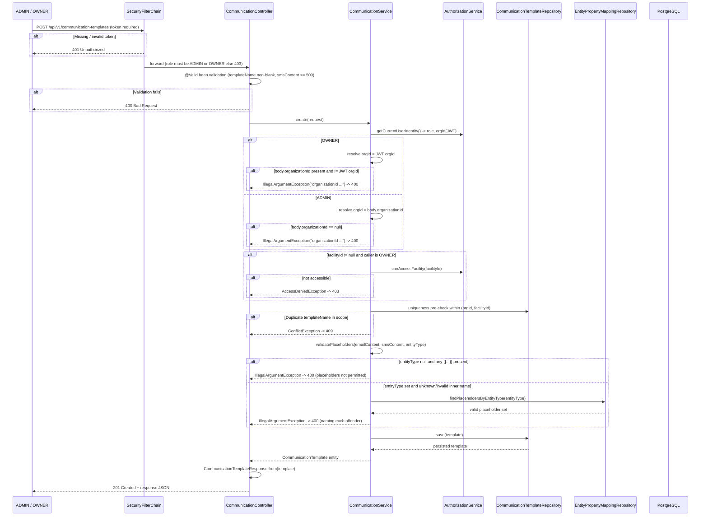
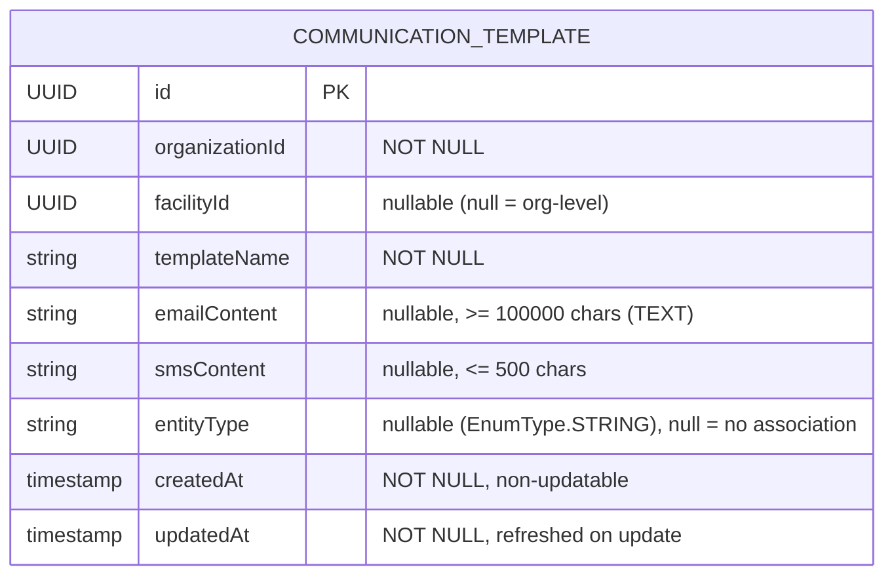

# Design Document: Communication Template API

## Overview

The Communication Template API is the first domain feature of the new **storage-manager-communications** service: a **Communication_Template**, representing reusable email and SMS content that staff can apply when messaging customers. Every Communication Template belongs to exactly one **Organization** (`organizationId`, NOT NULL) and MAY optionally belong to a single **Facility** within that Organization (`facilityId`, nullable). A template with a null `facilityId` is an **Org_Level_Template** that applies across the Organization; a template with a non-null `facilityId` is a **Facility_Level_Template** scoped to one Facility.

> **Relocation note.** This feature was originally implemented in `storage-manager-api` (its `V19__create_communication_templates.sql` migration) and has been moved to `storage-manager-communications` so the service that renders and sends messages owns the template store. The behavior contract is preserved; the migration is renumbered to **V1** in this service's own Flyway history. Because the communications service does not own the Organization, Facility, or `user_identities` tables, two adaptations apply and are called out below: (a) `UserIdentity` is a **claims-derived value object** populated from the JWT rather than a persisted entity, and (b) `CommunicationService` does **not** inject `OrganizationRepository`/`FacilityRepository` and therefore does not perform Organization-existence or Facility-in-Organization database checks (those tables live in the api). The role-based org resolution, OWNER org-scoping, owner facility-access gate, and `(organizationId, facilityId)` name-uniqueness logic are all retained.

The feature adds a `CommunicationController` exposing four operations under the `/api/v1/communication-templates` path prefix:

1. **Create a template** (`POST`) — permitted for ADMIN or OWNER; returns `201 Created`.
2. **List templates** (`GET`, paginated) — org-scoped; OWNER derives the org from the JWT, ADMIN supplies it as a request parameter.
3. **Get a template by id** (`GET /{id}`) — org-scoped for OWNER, unrestricted-by-org for ADMIN.
4. **Partially update a template** (`PATCH /{id}`) — permitted for ADMIN or OWNER.

The design follows the established Storage Manager conventions:

- A JPA entity (`CommunicationTemplate`) with `@PrePersist`/`@PreUpdate` lifecycle callbacks for timestamps.
- Jakarta Bean Validation request DTO records (`CreateCommunicationTemplateRequest`, `UpdateCommunicationTemplateRequest`).
- A response DTO record (`CommunicationTemplateResponse`) with a static `from(CommunicationTemplate)` mapper that preserves null values.
- A `@Transactional` service (`CommunicationService`) holding all business logic, including org/facility scoping, owner facility-access validation, and uniqueness enforcement.
- A Spring Data repository (`CommunicationTemplateRepository`) for org-scoped paginated queries and uniqueness checks.
- Custom exceptions handled centrally by `GlobalExceptionHandler` (`ConflictException` → 409, `EntityNotFoundException` → 404, validation → 400, `AccessDeniedException` → 403, `AuthenticationException` → 401).
- Role-based access control via Spring Security `@PreAuthorize` expressions backed by the `authz` (`AuthorizationService`) bean, including its `canAccessFacility(UUID)` and `isAdmin()` rules.
- The `PagedResponse<T>` wrapper for paginated list results.

Two aspects distinguish the Communication Template endpoints from a plain facility-scoped CRUD controller:

- **The scope is the Organization, not a single Facility.** A Communication Template always carries an `organizationId` and *optionally* a `facilityId`. The owning org for an OWNER is derived from the JWT (`authz.getCurrentUserIdentity().getOrganizationId()`), never from the request body/param; an ADMIN supplies the org explicitly (in the create body, and as a required query param on list).
- **Template-name uniqueness is scoped to the `(organizationId, facilityId)` pair.** This is enforced at two layers: a database unique constraint on `(organization_id, facility_id, template_name)` for facility-level rows, a *partial* unique index covering org-level rows (where `facility_id IS NULL`) to resolve PostgreSQL's "NULLs are distinct" behavior, and a service-level pre-check that raises a clean `ConflictException` before the insert.

Package root: `com.storagemanager.communications` (parallels `com.storagemanager.api`).

### Entity-type association and placeholder validation

This feature additionally associates each template with an optional **entity type** and validates the placeholders embedded in template content against the placeholders defined for that entity type. `CommunicationTemplate` carries a single, **nullable** `entityType` (`com.storagemanager.communications.model.EntityType`, the enum owned by the entity-api feature in this same service), persisted as a string. Template content (`emailContent` and `smsContent`) MAY embed placeholders using the `{{inner-name}}` syntax. On **both create and update**, the `CommunicationService` validates placeholders at write time against the **effective (post-apply)** `emailContent`, `smsContent`, and `entityType`: when the effective `entityType` is non-null, every `{{...}}` occurrence across both content fields must resolve to a defined `EntityPropertyMapping` placeholder for that entity type (reading the **global** mapping set, independent of the template's org/facility scope); when the effective `entityType` is null, the content must contain no `{{...}}` occurrences at all. Validation is write-time only — existing templates are not re-validated when mappings later change (Requirement 11, 3.9–3.11, 6.13–6.17).

---

## Architecture

```mermaid
graph TD
    Admin["ADMIN (cross-org)"] -->|create / list(org param) / get / update| CC["CommunicationController"]
    Owner["OWNER (org from JWT)"] -->|create / list / get / update| CC
    CC --> CS["CommunicationService"]
    CS --> CTR["CommunicationTemplateRepository"]
    CS --> EPMR["EntityPropertyMappingRepository (placeholder lookup by entityType)"]
    CS --> AZ["AuthorizationService (authz: isAdmin, hasRole, getCurrentUserIdentity, canAccessFacility)"]
    CTR --> DB[("PostgreSQL (communication_templates)")]
    EPMR --> DB2[("PostgreSQL (entity_property_mappings)")]
    CC --> GEH["GlobalExceptionHandler"]
    SEC["SecurityConfig (all paths authenticated)"] -.-> CC
    JWT["CustomJwtAuthenticationConverter (claims -> UserIdentity)"] -.-> AZ
```

> **Relocation adaptation:** unlike the api, there is no `OrganizationRepository`/`FacilityRepository` collaborator here — the communications service does not own those tables. `AuthorizationService` is claims-based: it reads the current `UserIdentity` (role + `organizationId`) from the JWT authentication details produced by `CustomJwtAuthenticationConverter`.

> **Placeholder-validation collaborator.** For entity-type placeholder validation (Requirement 11), `CommunicationService` injects the existing `EntityPropertyMappingRepository` (owned by the entity-api feature, same module and package `com.storagemanager.communications.repository`) to look up the valid placeholders for a template's effective `entityType`. The service fetches the **set** of valid placeholders for an `entityType` in one query and validates the extracted placeholder set against it, rather than issuing one `existsByEntityTypeAndPlaceholder` call per distinct placeholder. This adds a lightweight projection/derived query to `EntityPropertyMappingRepository` — `List<String> findPlaceholdersByEntityType(EntityType entityType)` (a derived projection selecting the `placeholder` column) — alongside its existing `existsByEntityTypeAndPlaceholder` and paginated finders. The repository is read-only from this feature's perspective; the entity-api feature remains the sole writer of mappings.

### Layered Architecture

| Layer | Class | Responsibility |
|---|---|---|
| Controller | `CommunicationController` | HTTP routing, request validation (`@Valid`), declarative role gate (`@PreAuthorize`), page/size validation and capping, the ADMIN `organizationId` request-param contract on list, response mapping |
| Service | `CommunicationService` | Business logic: org resolution per role (JWT vs. param/body), owner facility-access validation, Org_Level/Facility_Level scoping of reads and writes, partial update with null-field preservation, `updatedAt` refresh, service-level uniqueness enforcement raising `ConflictException`, **write-time placeholder validation against the effective (post-apply) content/`entityType` using the global mapping set**, transaction boundary |
| Repository | `CommunicationTemplateRepository` | Data access: org-scoped paginated query ordered by `createdAt` DESC; existence-by-scope queries for the uniqueness pre-check (facility-level and org-level/`facilityId IS NULL`) |
| Repository (read-only) | `EntityPropertyMappingRepository` | Reused from entity-api: the new `findPlaceholdersByEntityType(entityType)` projection returns the global set of valid placeholder inner names for an `entityType`, backing placeholder validation. This feature only reads it |
| Security | `SecurityConfig` | All `/api/v1/communication-templates*` paths fall under `anyRequest().authenticated()`; no `permitAll` entry is added. `CustomJwtAuthenticationConverter` derives `UserIdentity` from JWT claims |

### Request Lifecycle — Create



> **Relocation adaptation:** the api's create flow additionally called `OrganizationRepository.existsById` (→ 404 when the org did not exist) and `FacilityRepository.findById` to confirm the facility belonged to the org (→ 404 otherwise). The communications service does not own those tables, so those two existence checks are omitted; the `organizationId`/`facilityId` are recorded as the template's scope. The OWNER `canAccessFacility` gate and all uniqueness checks are retained.

### Request Lifecycle — List

```mermaid
sequenceDiagram
    participant C as ADMIN / OWNER
    participant Ctrl as CommunicationController
    participant Svc as CommunicationService
    participant AZ as AuthorizationService
    participant Repo as CommunicationTemplateRepository

    C->>Ctrl: GET /api/v1/communication-templates?organizationId=&page=&size=
    Ctrl->>Ctrl: validate page>=0, size>=1; cappedSize = min(size, 100)
    Ctrl->>Svc: list(organizationIdParam, pageable)
    Svc->>AZ: getCurrentUserIdentity() -> role, orgId(JWT)
    alt OWNER
        Svc->>Svc: effectiveOrgId = JWT orgId (param ignored)
    else ADMIN
        alt organizationIdParam == null
            Svc-->>Ctrl: IllegalArgumentException("organizationId required for ADMIN") -> 400
        end
        Svc->>Svc: effectiveOrgId = organizationIdParam
    end
    Svc->>Repo: findByOrganizationIdOrderByCreatedAtDesc(effectiveOrgId, pageable)
    Repo-->>Svc: Page<CommunicationTemplate>
    Svc-->>Ctrl: Page
    Ctrl->>Ctrl: PagedResponse.from(page.map(from))
    Ctrl-->>C: 200 OK + PagedResponse (content, page, totalPages, totalElements)
```

### Request Lifecycle — Update (PATCH)

```mermaid
sequenceDiagram
    participant C as ADMIN / OWNER
    participant Ctrl as CommunicationController
    participant Svc as CommunicationService
    participant AZ as AuthorizationService
    participant Repo as CommunicationTemplateRepository
    participant EPMR as EntityPropertyMappingRepository

    C->>Ctrl: PATCH /api/v1/communication-templates/{id} (token required)
    alt {id} not a valid UUID
        Ctrl-->>C: 400 Bad Request (MethodArgumentTypeMismatchException)
    end
    Ctrl->>Ctrl: @Valid (templateName non-blank-if-present, smsContent <= 500)
    alt Validation fails (one or more fields)
        Ctrl-->>C: 400 Bad Request (all failing fields listed)
    end
    Ctrl->>Svc: update(id, request)
    Svc->>Repo: findById(id)
    alt Not found
        Svc-->>Ctrl: EntityNotFoundException -> 404
    end
    Svc->>AZ: getCurrentUserIdentity() -> role, orgId(JWT)
    alt OWNER and template.organizationId != JWT orgId
        Svc-->>Ctrl: AccessDeniedException -> 403
    end
    alt OWNER and template.facilityId != null
        Svc->>AZ: canAccessFacility(template.facilityId)
        alt not accessible
            Svc-->>Ctrl: AccessDeniedException -> 403
        end
    end
    alt request.templateName non-null and differs from current
        Svc->>Repo: uniqueness pre-check within (orgId, facilityId)
        alt Duplicate in scope
            Svc-->>Ctrl: ConflictException -> 409
        end
    end
    Svc->>Svc: apply each non-null field (incl. entityType); leave null fields unchanged
    Svc->>Svc: validatePlaceholders(effective emailContent, smsContent, entityType)
    alt entityType null and any {{...}} present
        Svc-->>Ctrl: IllegalArgumentException -> 400 (placeholders not permitted)
    else entityType set and unknown/invalid inner name
        Svc->>EPMR: findPlaceholdersByEntityType(entityType)
        EPMR-->>Svc: valid placeholder set
        Svc-->>Ctrl: IllegalArgumentException -> 400 (naming each offender)
    end
    Svc->>Repo: save(template)  %% @PreUpdate refreshes updatedAt
    Svc-->>Ctrl: CommunicationTemplate entity
    Ctrl-->>C: 200 OK + response JSON
```

---

## Components and Interfaces

### CommunicationController

All four routes share the `/api/v1/communication-templates` base path. Every endpoint requires authentication, and a method-level `@PreAuthorize` restricts callers to the ADMIN or OWNER role (Requirement 8.1, 8.6, 8.7). Because the role gate is declarative, an unauthorized caller receives `403` before any business logic runs — regardless of whether the referenced template exists (Requirement 8.7).

| Method | Path | Auth | Description |
|---|---|---|---|
| `POST` | `/api/v1/communication-templates` | ADMIN or OWNER | Create a template; returns `CommunicationTemplateResponse`, `201 Created` |
| `GET` | `/api/v1/communication-templates` | ADMIN or OWNER | List templates (paginated); ADMIN **must** pass `organizationId`, OWNER derives org from JWT; returns `PagedResponse<CommunicationTemplateResponse>`, `200 OK` |
| `GET` | `/api/v1/communication-templates/{id}` | ADMIN or OWNER | Fetch one template by id; returns `CommunicationTemplateResponse`, `200 OK` |
| `PATCH` | `/api/v1/communication-templates/{id}` | ADMIN or OWNER | Partially update a template; returns `CommunicationTemplateResponse`, `200 OK` |

**Authorization expressions.** Every method carries the same role gate so the role check runs before business logic (Requirement 8.1, 8.7):

```java
@PreAuthorize("@authz.isAdmin() or @authz.hasRole('OWNER')")
```

The finer-grained, data-dependent decisions — resolving the OWNER's org from the JWT, requiring the ADMIN `organizationId` param, verifying the OWNER owns the target org/facility — depend on the loaded entity or the request contents and are therefore made inside `CommunicationService`.

**Pagination handling:** validate `page >= 0` and `size >= 1` (throwing `IllegalArgumentException` → `400` for invalid values), then cap size at 100 via `Math.min(size, 100)` before building the `PageRequest`. The capped size flows through `PageRequest`, so `PagedResponse` reports the effective capped page size in its metadata (Requirement 4.7).

```java
@RestController
public class CommunicationController {

    private final CommunicationService communicationService;

    public CommunicationController(CommunicationService communicationService) {
        this.communicationService = communicationService;
    }

    @PostMapping("/api/v1/communication-templates")
    @ResponseStatus(HttpStatus.CREATED)
    @PreAuthorize("@authz.isAdmin() or @authz.hasRole('OWNER')")
    public CommunicationTemplateResponse create(
            @Valid @RequestBody CreateCommunicationTemplateRequest request) {
        return CommunicationTemplateResponse.from(communicationService.create(request));
    }

    @GetMapping("/api/v1/communication-templates")
    @PreAuthorize("@authz.isAdmin() or @authz.hasRole('OWNER')")
    public PagedResponse<CommunicationTemplateResponse> list(
            @RequestParam(required = false) UUID organizationId,
            @RequestParam(defaultValue = "0") int page,
            @RequestParam(defaultValue = "20") int size) {
        if (page < 0) {
            throw new IllegalArgumentException("page must be >= 0");
        }
        if (size < 1) {
            throw new IllegalArgumentException("size must be >= 1");
        }
        int cappedSize = Math.min(size, 100);
        Pageable pageable = PageRequest.of(page, cappedSize);
        return PagedResponse.from(
                communicationService.list(organizationId, pageable)
                        .map(CommunicationTemplateResponse::from));
    }

    @GetMapping("/api/v1/communication-templates/{id}")
    @PreAuthorize("@authz.isAdmin() or @authz.hasRole('OWNER')")
    public CommunicationTemplateResponse get(@PathVariable UUID id) {
        return CommunicationTemplateResponse.from(communicationService.get(id));
    }

    @PatchMapping("/api/v1/communication-templates/{id}")
    @PreAuthorize("@authz.isAdmin() or @authz.hasRole('OWNER')")
    public CommunicationTemplateResponse update(
            @PathVariable UUID id,
            @Valid @RequestBody UpdateCommunicationTemplateRequest request) {
        return CommunicationTemplateResponse.from(communicationService.update(id, request));
    }
}
```

> **Note on invalid-UUID path variables (Requirements 5.5, 6.9):** When the `{id}` path segment is not a valid UUID, Spring fails to bind `@PathVariable UUID id` and raises a `MethodArgumentTypeMismatchException` before the controller body runs. `GlobalExceptionHandler` maps this to `400 Bad Request`.

> **Note on `hasRole` expression:** `AuthorizationService` exposes `hasRole(String)` which compares against the `UserRole` name. `@authz.hasRole('OWNER')` returns true only for an OWNER token; combined with `@authz.isAdmin()` the gate admits exactly ADMIN and OWNER, and `STAFF`/`TENANT` tokens are rejected with `403` (Requirement 8.6).

### CommunicationService

```java
@Service
@Transactional
public class CommunicationService {

    private final CommunicationTemplateRepository templateRepository;
    private final EntityPropertyMappingRepository mappingRepository;
    private final AuthorizationService authz;

    public CommunicationService(CommunicationTemplateRepository templateRepository,
                                EntityPropertyMappingRepository mappingRepository,
                                AuthorizationService authz) {
        this.templateRepository = templateRepository;
        this.mappingRepository = mappingRepository;
        this.authz = authz;
    }

    public CommunicationTemplate create(CreateCommunicationTemplateRequest request) { ... }

    @Transactional(readOnly = true)
    public Page<CommunicationTemplate> list(UUID organizationIdParam, Pageable pageable) { ... }

    @Transactional(readOnly = true)
    public CommunicationTemplate get(UUID id) { ... }

    public CommunicationTemplate update(UUID id, UpdateCommunicationTemplateRequest request) { ... }
}
```

> **Relocation adaptation:** the api's `CommunicationService` injected `OrganizationRepository` and `FacilityRepository` for existence checks. This service injects `CommunicationTemplateRepository`, `AuthorizationService`, and (for placeholder validation) the read-only `EntityPropertyMappingRepository`; the Organization-existence and Facility-in-Organization checks are dropped (see Create behavior below).

| Method | Behavior |
|---|---|
| `create(request)` | **Org resolution (Req 2.3–2.6):** reads the current identity from `authz.getCurrentUserIdentity()`. For an OWNER, the effective `organizationId` is the JWT org; if the request also supplies an `organizationId` that differs from the JWT org, throw `IllegalArgumentException("organizationId must match the authenticated organization")` → `400`. For an ADMIN, the effective org is `request.organizationId()`; if it is null, throw `IllegalArgumentException("organizationId is required for ADMIN callers")` → `400`. **Facility handling (Req 2.7–2.9, 10.1):** when `facilityId` is null, persist as an Org_Level_Template. When non-null and the caller is an OWNER, verify `authz.canAccessFacility(facilityId)` else `AccessDeniedException` → `403`. (Org-existence and facility-in-org DB verification are not performed in this service.) **Uniqueness (Req 2.10, 2.11, 9):** run the scope pre-check (below) and throw `ConflictException` → `409` on a duplicate. **Placeholder validation (Req 3.9–3.11, 11):** set `entityType` from the request (an unknown enum string has already failed Jackson binding → `400`), then run `validatePlaceholders(emailContent, smsContent, entityType)` (below) against the effective content, throwing `IllegalArgumentException` → `400` on failure. Then build and `save` the entity. |
| `list(organizationIdParam, pageable)` | Resolves the effective org per role: OWNER → JWT org (the param is ignored); ADMIN → `organizationIdParam`, throwing `IllegalArgumentException("organizationId request parameter is required for ADMIN callers")` → `400` when it is null (Req 4.2–4.4). Returns `templateRepository.findByOrganizationIdOrderByCreatedAtDesc(effectiveOrgId, pageable)` — templates newest-first, scoped to exactly one org (Req 4.6). An empty scope yields an empty page → `200 OK` with empty `content` and `totalElements = 0` (Req 4.8). |
| `get(id)` | Loads the template (`EntityNotFoundException` → `404` if missing, Req 5.4). For an ADMIN, returns it regardless of org (Req 5.2). For an OWNER, returns it only when `template.getOrganizationId()` equals the JWT org; otherwise throws `AccessDeniedException` → `403` whose body matches the standard error format (Req 5.3, 5.6). |
| `update(id, request)` | Loads the template (`EntityNotFoundException` → `404`, Req 6.8). **Access (Req 6.11, 10.2, 10.3):** for an OWNER, require `template.getOrganizationId()` equals the JWT org; and when `template.getFacilityId()` is non-null, require `authz.canAccessFacility(template.getFacilityId())`; a failure throws `AccessDeniedException` → `403`. **Uniqueness on rename (Req 6.12, 9):** when `request.templateName()` is non-null and differs from the current name, run the scope pre-check against the template's existing `(organizationId, facilityId)` and throw `ConflictException` → `409` on a collision. **Partial apply (Req 6.3, 6.4, 6.13–6.15):** set `templateName`, `emailContent`, `smsContent`, and `entityType` only when the corresponding request field is non-null; leave null fields unchanged (a null `entityType` leaves the existing association intact — clearing to null is out of scope this iteration). **Placeholder validation (Req 6.16, 6.17, 11):** after applying the request, run `validatePlaceholders(...)` against the template's **effective (post-apply)** `emailContent`, `smsContent`, and `entityType`, throwing `IllegalArgumentException` → `400` on failure. `save` the entity; the `@PreUpdate` callback refreshes `updatedAt` (Req 6.10). |

**Uniqueness pre-check (service level, Req 1.11, 9.1–9.6, 9.8).** The service enforces scope uniqueness before persistence so callers receive a clean `409` instead of a raw constraint violation:

```java
private void requireUniqueName(UUID organizationId, UUID facilityId, String templateName) {
    boolean exists = (facilityId == null)
            ? templateRepository.existsByOrganizationIdAndFacilityIdIsNullAndTemplateName(
                    organizationId, templateName)
            : templateRepository.existsByOrganizationIdAndFacilityIdAndTemplateName(
                    organizationId, facilityId, templateName);
    if (exists) {
        throw new ConflictException(
                "A communication template named '" + templateName + "' already exists in this scope");
    }
}
```

Because `facilityId == null` cannot be matched by an equality query (`= NULL` is never true in SQL), the org-level branch uses a dedicated `...FacilityIdIsNull...` derived query; the facility-level branch uses the three-column equality query. This mirrors the two database-level guarantees (the composite unique constraint for facility rows and the partial unique index for org-level rows).

**Owner facility-access validation (Req 10.1–10.3).** The create path validates a supplied non-null `facilityId` with `authz.canAccessFacility(facilityId)`; the update path validates the loaded template's own `facilityId` the same way.

**Placeholder validation (service level, Req 11.1–11.9, 3.9–3.11, 6.13–6.17).** Both the create and update paths call a single private helper against the effective (post-apply) content and entity type:

```java
private static final Pattern PLACEHOLDER = Pattern.compile("\\{\\{(.*?)\\}\\}");
private static final Pattern INNER_NAME = Pattern.compile("^[a-z0-9]+(-[a-z0-9]+)*$");

private void validatePlaceholders(String emailContent, String smsContent, EntityType entityType) {
    // 1. Extract every {{...}} occurrence from BOTH fields; a null field contributes zero
    //    occurrences. Trim leading/trailing ASCII whitespace from the inner content to get
    //    the inner name (Req 11.1).
    List<String> innerNames = new ArrayList<>();
    extractInto(emailContent, innerNames);
    extractInto(smsContent, innerNames);

    // 2. entityType == null: ANY {{...}} occurrence is rejected (Req 11.4).
    if (entityType == null) {
        if (!innerNames.isEmpty()) {
            throw new IllegalArgumentException(
                    "Placeholders are not permitted when the template has no entityType");
        }
        return;
    }

    // 3. Any inner name that is empty-after-trim or not matching ^[a-z0-9]+(-[a-z0-9]+)*$
    //    is itself an invalid placeholder (Req 11.9).
    Set<String> invalidFormat = innerNames.stream()
            .filter(n -> n.isEmpty() || !INNER_NAME.matcher(n).matches())
            .collect(toCollection(LinkedHashSet::new));
    if (!invalidFormat.isEmpty()) {
        throw new IllegalArgumentException(
                "Invalid placeholder(s): " + String.join(", ", invalidFormat));
    }

    // 4. Fetch the GLOBAL valid-placeholder set for this entityType in ONE query and check the
    //    extracted set against it; zero occurrences is fine (Req 11.2, 11.5, 11.7).
    Set<String> valid = new HashSet<>(mappingRepository.findPlaceholdersByEntityType(entityType));
    Set<String> unknown = innerNames.stream()
            .filter(n -> !valid.contains(n))
            .collect(toCollection(LinkedHashSet::new));
    if (!unknown.isEmpty()) {
        throw new IllegalArgumentException(
                "Unknown placeholder(s) for entityType " + entityType + ": "
                        + String.join(", ", unknown));
    }
}
```

- **Extraction (Req 11.1):** `extractInto` matches `\{\{(.*?)\}\}` over the content (null content ⇒ zero matches), trims leading/trailing ASCII whitespace from each captured inner content, and collects the inner names. The presence of any `{{...}}` pair is itself the validation trigger — there is no supported escape (Req 11.5).
- **entityType null (Req 11.4):** any occurrence at all is rejected with a message indicating placeholders are not permitted without an `entityType`.
- **Invalid inner-name form (Req 11.9):** an empty-after-trim inner name, or one not matching `^[a-z0-9]+(-[a-z0-9]+)*$`, is reported as an invalid placeholder, naming each **distinct** offender.
- **Unknown placeholder (Req 11.2, 11.3):** the extracted set is validated against the global placeholder set fetched once via `mappingRepository.findPlaceholdersByEntityType(entityType)`; any inner name absent from that set is reported, naming each **distinct** offender. Zero occurrences pass trivially.
- **Global, write-time only (Req 11.6, 11.7, 11.8):** the mapping set is read globally, independent of the template's `organizationId`/`facilityId`, and validation runs only on create/update — existing templates are never re-validated when mappings later change.

> `IllegalArgumentException` from these checks is already mapped to `400` by `GlobalExceptionHandler` (see Error Handling), so no new exception type is introduced.

> **Relocation adaptation to `canAccessFacility`:** in the api, `canAccessFacility` resolved the facility from `FacilityRepository` and compared its `organizationId` to the caller's. The communications service has no facility table, so its `AuthorizationService.canAccessFacility` grants ADMIN unconditionally and, for a non-admin caller, cannot resolve facility→org and therefore returns true at this layer; the authoritative org-scoping decision is enforced in `CommunicationService` by comparing a template's own `organizationId` to the caller's token org. If strict facility-in-org validation is later required, it would be added via a service-to-service read to `storage-manager-api`.

### CommunicationTemplateRepository

```java
public interface CommunicationTemplateRepository extends JpaRepository<CommunicationTemplate, UUID> {

    Page<CommunicationTemplate> findByOrganizationIdOrderByCreatedAtDesc(
            UUID organizationId, Pageable pageable);

    boolean existsByOrganizationIdAndFacilityIdAndTemplateName(
            UUID organizationId, UUID facilityId, String templateName);

    boolean existsByOrganizationIdAndFacilityIdIsNullAndTemplateName(
            UUID organizationId, String templateName);
}
```

| Method | Purpose |
|---|---|
| `findByOrganizationIdOrderByCreatedAtDesc(organizationId, pageable)` | Org-scoped list, newest first — guarantees a list request can never leak templates from another org (Req 4.2, 4.3, 4.6) |
| `existsByOrganizationIdAndFacilityIdAndTemplateName(organizationId, facilityId, templateName)` | Facility-level uniqueness pre-check within scope `(organizationId, facilityId)` (Req 9.1, 9.5) |
| `existsByOrganizationIdAndFacilityIdIsNullAndTemplateName(organizationId, templateName)` | Org-level uniqueness pre-check among rows where `facilityId IS NULL` (Req 1.11, 9.4, 9.8) |

**New query on `EntityPropertyMappingRepository` (entity-api feature).** Placeholder validation adds one lightweight derived projection to the existing `EntityPropertyMappingRepository`, returning the global set of valid placeholder inner names for an `entityType` in a single query:

```java
// added to com.storagemanager.communications.repository.EntityPropertyMappingRepository
List<String> findPlaceholdersByEntityType(EntityType entityType);
```

| Method | Purpose |
|---|---|
| `findPlaceholdersByEntityType(entityType)` | Returns every `placeholder` defined for `entityType` as a `List<String>`; `CommunicationService` loads it into a set once per validation and checks the extracted placeholders against it (Req 11.2, 11.7) |

### AuthorizationService and UserIdentity (relocation adaptation)

`AuthorizationService` is registered as the `authz` bean and exposes `isAdmin()`, `hasRole(String)`, `getCurrentUserIdentity()`, `canAccessOrganization(UUID)`, and `canAccessFacility(UUID)` so the `@PreAuthorize` expressions port unchanged from the api.

`UserIdentity` is a plain claims-derived value object (not a JPA entity): `(String sub, UserRole role, UUID organizationId)`. It is produced by `CustomJwtAuthenticationConverter`, which reads the role from the configured role claim (`app.security.jwt.role-claim`, default `custom:role`) and the organization from the `organizationId` claim, and attaches the `UserIdentity` as the authentication details. This replaces the api's persisted `user_identities` lookup, since the communications service does not own that table.

---

## Data Models

### CommunicationTemplate Entity



A Communication Template carries its owning `organizationId` and optional `facilityId` as plain UUID columns — there is no JPA foreign-key association object, only the id values, which the service and repository use for scoping and authorization.

### JPA Entity: `CommunicationTemplate`

```java
@Entity
@Table(
    name = "communication_templates",
    uniqueConstraints = @UniqueConstraint(
        name = "uq_comm_tmpl_org_facility_name",
        columnNames = {"organization_id", "facility_id", "template_name"}
    )
)
public class CommunicationTemplate {

    @Id
    @GeneratedValue(strategy = GenerationType.UUID)
    private UUID id;

    @Column(name = "organization_id", nullable = false)
    private UUID organizationId;

    @Column(name = "facility_id")
    private UUID facilityId;

    @Column(name = "template_name", nullable = false)
    private String templateName;

    @Column(name = "email_content", columnDefinition = "TEXT")
    private String emailContent;

    @Column(name = "sms_content", length = 500)
    private String smsContent;

    @Enumerated(EnumType.STRING)
    @Column(name = "entity_type")
    private EntityType entityType;

    @Column(nullable = false, updatable = false)
    private Instant createdAt;

    @Column(nullable = false)
    private Instant updatedAt;

    @PrePersist
    protected void onCreate() {
        Instant now = Instant.now();
        this.createdAt = now;
        this.updatedAt = now;
    }

    @PreUpdate
    protected void onUpdate() {
        this.updatedAt = Instant.now();
    }

    // getters / setters ...
}
```

> `facilityId` is **nullable** so an Org_Level_Template persists with a null `facility_id`. `emailContent` uses `columnDefinition = "TEXT"` to hold long HTML well beyond 100,000 characters (Req 1.6). `smsContent` uses `length = 500` so the generated column is `VARCHAR(500)` (Req 1.7); the DTO-level `@Size(max = 500)` produces the clean `400`, while the column length is the schema-level backstop. `entityType` is `@Enumerated(EnumType.STRING)` on a **nullable** `entity_type` column so the stored value is the literal enum name (`LEAD`) and a null denotes no association (Req 1.12); it reuses the `EntityType` enum (`com.storagemanager.communications.model.EntityType`) owned by the entity-api feature, with a getter/setter alongside the other fields. The table-level `@UniqueConstraint` declares the composite `(organization_id, facility_id, template_name)` guarantee for facility-level rows (Req 1.10, 9.7); the org-level partial unique index is added in the Flyway migration, since JPA annotations cannot express a `WHERE facility_id IS NULL` partial index.

### Request DTOs

**CreateCommunicationTemplateRequest** — `templateName` is required with `@NotBlank`; `organizationId` is optional at the Bean-Validation layer (its requiredness for ADMIN is a role-dependent service rule, per Req 3.2); `facilityId`, `emailContent` are optional; `smsContent` is optional and bounded by `@Size(max = 500)`:

```java
public record CreateCommunicationTemplateRequest(
        UUID organizationId,
        UUID facilityId,
        @NotBlank String templateName,
        String emailContent,
        @Size(max = 500) String smsContent,
        EntityType entityType
) {}
```

> `@NotBlank` on `templateName` yields `400 Bad Request` identifying `templateName` when it is null or blank (Req 3.1, 3.7). `@Size(max = 500)` on `smsContent` yields `400` identifying `smsContent` when the value exceeds 500 characters (Req 3.6); a null `smsContent` passes. `entityType` is an optional (nullable) `EntityType` associating the template with a single entity type (Req 3.9); because it binds directly to the enum, an unknown string value fails Jackson deserialization as `HttpMessageNotReadableException` → `400` naming `entityType` **before** `@Valid` runs — the same mechanism entity-api uses (Req 3.10). A malformed body is handled by the `HttpMessageNotReadableException` handler → `400` "Malformed JSON request body" (Req 3.8). The requiredness of `organizationId` for ADMIN callers is enforced in `CommunicationService` (not via `@NotNull`) because it depends on the caller's role; the service throws `IllegalArgumentException` identifying the `organizationId` field → `400` (Req 2.5, 3.2). Placeholder validation on the effective content/`entityType` runs in the service (Req 3.11).

**UpdateCommunicationTemplateRequest** — every field optional (nullable) for PATCH semantics; `templateName` validated as non-blank only when present, and `smsContent` bounded by `@Size(max = 500)`:

```java
public record UpdateCommunicationTemplateRequest(
        @Pattern(regexp = "\\S.*", message = "must not be blank") String templateName,
        String emailContent,
        @Size(max = 500) String smsContent,
        EntityType entityType
) {}
```

> For PATCH, a `null` field means "leave unchanged", so the fields must not use `@NotBlank`. Instead, `templateName` uses `@Pattern(regexp = "\\S.*")` which, like `@Size`, passes on `null` but fails on a blank/whitespace-only string — yielding `400` identifying `templateName` only when a blank value is supplied (Req 6.6). `@Size(max = 500)` on `smsContent` behaves identically to the create DTO (Req 6.5). `entityType` is an optional (nullable) `EntityType` (Req 6.13); a non-null value updates the association (Req 6.14) while a null value leaves it unchanged — consistent with the partial-update semantics, so clearing an `entityType` back to null is out of scope this iteration (Req 6.15). An unknown enum string again fails Jackson binding as `HttpMessageNotReadableException` → `400` naming `entityType` (Req 6.16). When more than one field violates its constraint, Spring's `MethodArgumentNotValidException` aggregates all field errors into a single `400` listing every failing field (Req 6.7), joined with "; " by `GlobalExceptionHandler`. Placeholder validation on the effective (post-apply) content/`entityType` runs in the service (Req 6.17).

### Response DTO

**CommunicationTemplateResponse** — contains every template field; populated field-for-field by the static `from` mapper, preserving nulls for `facilityId`, `emailContent`, `smsContent`, and `entityType` (Req 7.1, 7.2, 7.3):

```java
public record CommunicationTemplateResponse(
        UUID id,
        UUID organizationId,
        UUID facilityId,
        String templateName,
        String emailContent,
        String smsContent,
        EntityType entityType,
        Instant createdAt,
        Instant updatedAt
) {
    public static CommunicationTemplateResponse from(CommunicationTemplate template) {
        return new CommunicationTemplateResponse(
                template.getId(),
                template.getOrganizationId(),
                template.getFacilityId(),
                template.getTemplateName(),
                template.getEmailContent(),
                template.getSmsContent(),
                template.getEntityType(),
                template.getCreatedAt(),
                template.getUpdatedAt()
        );
    }
}
```

> The `entityType` field is carried through by the `from` mapper, preserving a null value when the template is not associated with any entity type (Req 7.3).

### Pagination Wrapper

Reuses the `PagedResponse<T>` record (`content`, `page`, `totalPages`, `totalElements`) via `PagedResponse.from(Page<T>)`. The capped page size (`min(size, 100)`) flows into the `PageRequest`, so the returned `page`/`totalPages` metadata reflects the effective capped size (Req 4.7).

### Database Migration

**File:** `src/main/resources/db/migration/V1__create_communication_templates.sql`. This service has its own linear Flyway history starting at V1 (the api's original V19 renumbered). The migration creates the table, the composite unique constraint for facility-level rows, the partial unique index for org-level rows, and a supporting index for the org-scoped newest-first list query:

```sql
CREATE TABLE communication_templates (
    id              UUID PRIMARY KEY,
    organization_id UUID NOT NULL,
    facility_id     UUID,
    template_name   VARCHAR(255) NOT NULL,
    email_content   TEXT,
    sms_content     VARCHAR(500),
    created_at      TIMESTAMP WITH TIME ZONE NOT NULL,
    updated_at      TIMESTAMP WITH TIME ZONE NOT NULL,
    CONSTRAINT uq_comm_tmpl_org_facility_name
        UNIQUE (organization_id, facility_id, template_name)
);

-- Org-level uniqueness: PostgreSQL treats NULLs as distinct inside unique
-- constraints, so the composite constraint above would allow duplicate org-level
-- template names (both with facility_id IS NULL). A partial unique index closes
-- that gap.
CREATE UNIQUE INDEX uq_comm_tmpl_org_name_facility_null
    ON communication_templates (organization_id, template_name)
    WHERE facility_id IS NULL;

-- Supports the org-scoped, newest-first list query.
CREATE INDEX idx_comm_tmpl_org_created_at
    ON communication_templates (organization_id, created_at DESC);
```

> The composite `UNIQUE` constraint and the partial unique index together form the database-level backstop for scope uniqueness (Req 1.10, 1.11, 9.7, 9.8). The service-level pre-check produces the clean `409` message; these constraints guarantee correctness even under a race between two concurrent inserts. The `(organization_id, created_at DESC)` index backs `findByOrganizationIdOrderByCreatedAtDesc`.

#### `V4__add_entity_type_to_communication_templates.sql` (entity-type association)

The entity-type association adds a single nullable column to the existing table. This service's linear Flyway history is **V1** = `create_communication_templates` (communication-api), **V2** = `messaging_inbox_outbox` (messaging), **V3** = `create_entity_property_mappings` (entity-api); the next free version is therefore **V4** (Req 1.13).

**File:** `src/main/resources/db/migration/V4__add_entity_type_to_communication_templates.sql`

```sql
ALTER TABLE communication_templates ADD COLUMN entity_type VARCHAR(64);
```

> The column is **nullable** — no `DEFAULT`, no `NOT NULL` — so existing rows keep a null `entity_type` (no association) and the migration is non-breaking (Req 1.12, 1.13). `VARCHAR(64)` is ample for enum names stored via `EnumType.STRING`, matching the `entity_type` column entity-api uses. Being a plain `ADD COLUMN` with no partial index or JSON type, the statement is portable to H2 PostgreSQL mode with no shim and runs identically under production PostgreSQL and the test database.

---

## Correctness Properties

*A property is a characteristic or behavior that should hold true across all valid executions of a system.*

The following properties are derived from the acceptance criteria. Each is universally quantified and references the requirements it validates. Properties are verified with mocked collaborators (`CommunicationTemplateRepository`, `AuthorizationService`) so logic can be exercised cheaply across 100+ generated inputs; schema-level and framework-level criteria (status codes, JSON binding, migrations) are covered by example/integration/smoke tests in the Testing Strategy instead.

### Property 1: Valid create round-trip

*For any* valid create request (non-blank `templateName`, `smsContent` within 500 characters, and either a null `facilityId` or a facility the caller may access), creating the template and then fetching it SHALL return a template whose `templateName`, `emailContent`, `smsContent`, `organizationId`, and `facilityId` equal the resolved values from the request.

**Validates: Requirements 2.2**

### Property 2: Create organization resolution and scoping

*For any* create request, the persisted `organizationId` SHALL equal the JWT organization when the caller is an OWNER, and SHALL equal the request body's `organizationId` when the caller is an ADMIN; and when the request omits `facilityId`, the persisted template SHALL be an Org_Level_Template with `facilityId` null.

**Validates: Requirements 2.3, 2.4, 2.8**

### Property 3: Create organization-resolution rejections

*For any* ADMIN create request that omits `organizationId`, and *for any* OWNER create request whose supplied `organizationId` differs from the JWT organization, the system SHALL reject the request with a `400 Bad Request` identifying the `organizationId` field, and SHALL NOT persist a template.

**Validates: Requirements 2.5, 2.6**

### Property 4: Scope uniqueness of template names

*For any* organization, optional facility, and template name, a create or rename SHALL be rejected with a `ConflictException` (`409`) if and only if a template with that name already exists within the identical Uniqueness_Scope `(organizationId, facilityId)` — where a null `facilityId` denotes the org-level scope — and templates occupying distinct scopes with the same name SHALL always be permitted.

**Validates: Requirements 1.11, 2.10, 2.11, 6.12, 9.1, 9.2, 9.3, 9.4, 9.5, 9.6**

### Property 5: Owner facility-access enforcement

*For any* OWNER create request supplying a non-null `facilityId`, and *for any* OWNER update targeting a Facility_Level_Template, the operation SHALL be rejected with a `403 Forbidden` in the standard error format whenever `authz.canAccessFacility(facilityId)` is false, and SHALL be permitted whenever it is true.

**Validates: Requirements 2.9, 6.11, 10.1, 10.2, 10.3**

### Property 6: List read-scoping

*For any* backing set of templates spanning multiple organizations, listing SHALL return exactly those templates whose `organizationId` equals the applied scope — the JWT organization for an OWNER, or the `organizationId` request parameter for an ADMIN — including none from any other organization and omitting none from the applied scope.

**Validates: Requirements 4.2, 4.3, 8.2**

### Property 7: List rejects ADMIN without organization parameter

*For any* ADMIN list request that omits the `organizationId` request parameter, the system SHALL reject the request with a `400 Bad Request` identifying `organizationId` as required for ADMIN callers.

**Validates: Requirements 4.4, 8.3**

### Property 8: List ordering by creation time descending

*For any* backing set of templates within an organization, the content returned by a list request SHALL be ordered by `createdAt` descending.

**Validates: Requirements 4.6**

### Property 9: Get read-scoping

*For any* existing template, a get-by-id request SHALL return the template when the caller is an ADMIN or when the caller is an OWNER whose JWT organization equals the template's `organizationId`, and SHALL be denied with a `403 Forbidden` in the standard error format when the caller is an OWNER whose JWT organization differs.

**Validates: Requirements 5.2, 5.3, 5.6, 8.2**

### Property 10: Partial update preserves null fields and applies non-null fields

*For any* existing template and *any* update request, every field supplied as non-null SHALL equal the corresponding stored field after the update, and every field supplied as null SHALL leave the corresponding stored field equal to its value before the update.

**Validates: Requirements 6.3, 6.4**

### Property 11: Update refreshes updatedAt and preserves createdAt

*For any* existing template, performing an update SHALL set `updatedAt` to a timestamp no earlier than the pre-update `updatedAt` and SHALL leave `createdAt` unchanged.

**Validates: Requirements 1.8, 1.9, 6.10**

### Property 12: smsContent length validation

*For any* string value supplied as `smsContent` on a create or update request, the request SHALL be rejected with a `400 Bad Request` identifying `smsContent` when the value exceeds 500 characters, and SHALL pass this validation when the value is null or at most 500 characters.

**Validates: Requirements 3.6, 6.5**

### Property 13: templateName validity

*For any* `templateName` value, a create request SHALL be rejected with a `400 Bad Request` identifying `templateName` when the value is null or consists only of whitespace, and an update request SHALL be rejected with a `400 Bad Request` identifying `templateName` when a value is supplied that consists only of whitespace.

**Validates: Requirements 3.1, 3.7, 6.6**

### Property 14: Response mapping preserves all fields

*For any* template entity, the `CommunicationTemplateResponse.from` mapping SHALL populate `id`, `organizationId`, `facilityId`, `templateName`, `emailContent`, `smsContent`, `createdAt`, and `updatedAt` with the identically-named entity field values, preserving null values for the nullable fields.

**Validates: Requirements 7.1, 7.2**

### Property 15: Role gate precedes business logic

*For any* authenticated caller lacking both the ADMIN and OWNER roles, every Communication Template endpoint SHALL return `403 Forbidden` regardless of whether the referenced id exists or is well-formed, and SHALL NOT execute create/read/update business logic.

**Validates: Requirements 8.1, 8.6, 8.7**

### Property 16: Placeholder validity under an entity type

*For any* effective (post-apply) `entityType` that is non-null, *any* global Entity_Property_Mapping placeholder set for that `entityType`, and *any* `emailContent`/`smsContent` (including null fields, and arbitrary org/facility scope), validation SHALL pass if and only if every `{{...}}` occurrence's trimmed inner name is both well-formed (matching `^[a-z0-9]+(-[a-z0-9]+)*$`) and present in that entity type's placeholder set; otherwise it SHALL be rejected with a `400 Bad Request` whose message names each distinct offending inner name, and zero `{{...}}` occurrences SHALL always pass. The outcome SHALL depend only on the content and `entityType`, independent of the template's `organizationId`/`facilityId`, and SHALL hold identically on both the create and update paths.

**Validates: Requirements 3.11, 6.17, 11.1, 11.2, 11.3, 11.5, 11.6, 11.7, 11.9**

### Property 17: No placeholders without an entity type

*For any* effective (post-apply) `entityType` that is null and *any* `emailContent`/`smsContent`, validation SHALL be rejected with a `400 Bad Request` indicating placeholders are not permitted without an `entityType` if and only if at least one `{{...}}` occurrence is present across the two content fields (null content contributing none); content with zero occurrences SHALL pass. This SHALL hold identically on both the create and update paths.

**Validates: Requirements 11.4, 11.6, 3.11, 6.17**

### Property 18: entityType persistence and response carry-through

*For any* create or update that resolves to an effective `entityType` (null or a defined value), the persisted template's `entityType` SHALL equal that effective value, and `CommunicationTemplateResponse.from` SHALL carry that same `entityType` through to the response, preserving null when no entity type is associated.

**Validates: Requirements 1.12, 6.14, 6.15, 7.3**

---

## Error Handling

All error responses use the `ErrorResponse` record (`timestamp`, `status`, `error`, `message`) produced by `GlobalExceptionHandler`. No new exception types are required; the feature reuses `ConflictException`, `EntityNotFoundException`, and the framework exceptions already mapped by the handler.

| Condition | Mechanism | Exception → Handler | HTTP |
|---|---|---|---|
| Missing / invalid JWT | Security filter chain (`CustomAuthenticationEntryPoint`) | `AuthenticationException` | `401` |
| Authenticated but role is not ADMIN/OWNER | `@PreAuthorize` on every method | `AccessDeniedException` | `403` |
| OWNER targets org/facility outside their scope | `CommunicationService` throws | `AccessDeniedException` | `403` |
| `templateName` null/blank, `smsContent` > 500 (one or more fields) | `@Valid` on request body | `MethodArgumentNotValidException` (field errors joined with "; ") | `400` |
| ADMIN missing `organizationId`; OWNER mismatched `organizationId` | `CommunicationService` throws | `IllegalArgumentException` | `400` |
| ADMIN list missing `organizationId` param | `CommunicationService` throws | `IllegalArgumentException` | `400` |
| `page < 0` or `size < 1` | `CommunicationController` throws | `IllegalArgumentException` | `400` |
| `{id}` not a valid UUID | Spring path-variable binding | `MethodArgumentTypeMismatchException` | `400` |
| Malformed JSON body | Jackson deserialization | `HttpMessageNotReadableException` | `400` |
| Unknown `entityType` enum value in create/update body | Jackson enum binding (before `@Valid`); handler names the `entityType` field — same mechanism as entity-api | `HttpMessageNotReadableException` (`InvalidFormatException` cause, target type `EntityType`) | `400` |
| Placeholder references unknown/malformed inner name for a non-null effective `entityType` | `CommunicationService.validatePlaceholders` throws, naming each distinct offender | `IllegalArgumentException` | `400` |
| `{{...}}` present while effective `entityType` is null | `CommunicationService.validatePlaceholders` throws | `IllegalArgumentException` | `400` |
| Template id not found (get/update) | `CommunicationService` throws | `EntityNotFoundException` | `404` |
| Duplicate `templateName` within scope | `CommunicationService` pre-check throws | `ConflictException` | `409` |
| Duplicate `templateName` lost race at the database | DB unique constraint / partial index | surfaced as a conflict | `409` |

> **Relocation adaptation:** the api additionally returned `404` for a non-existent `organizationId` or a `facilityId` not in the org, driven by `OrganizationRepository`/`FacilityRepository` lookups. Those rows are not owned by the communications service, so those two `404` conditions do not arise here; the remaining error contract is unchanged.

**Authorization-before-logic ordering (Req 8.7).** The method-level `@PreAuthorize` runs before the controller body, so a STAFF/TENANT caller is rejected with `403` before any repository access. Data-dependent authorization (OWNER org/facility scoping) runs after the entity is loaded, but still precedes any mutation and surfaces as `403`.

---

## Testing Strategy

The feature combines **property-based tests** (universal correctness properties over generated inputs), **example-based unit/web tests** (specific endpoints, status codes, framework behavior, and edge cases), and **integration/smoke tests** (schema and migration verification).

### Property-Based Tests

- **Library:** jqwik (the standard JUnit 5 property-based testing library for Java; the same version the api uses). Properties are **not** implemented from scratch.
- **Iterations:** each property test runs a minimum of 100 generated examples (`@Property(tries = 100)` where the default differs).
- **Isolation:** collaborators (`CommunicationTemplateRepository`, `AuthorizationService`, and — for placeholder validation — `EntityPropertyMappingRepository`) are mocked or backed by an in-memory fake so properties exercise `CommunicationService` logic cheaply without a real database or JWT. For the placeholder properties, the fake `EntityPropertyMappingRepository.findPlaceholdersByEntityType(entityType)` returns a generated "valid" placeholder set so the membership check is exercised without touching a real mappings table.
- **Generators:** cover org ids, facility ids (including null for org-level), template names (including whitespace-only and empty for validity properties), `emailContent` (including long/`null`), `smsContent` strings around the 500-character boundary (lengths 0, 1, 499, 500, 501, larger), and caller contexts across the ADMIN/OWNER/STAFF/TENANT roles with varying JWT org ids. For the placeholder properties (16, 17), generators additionally produce: a nullable `entityType`; a global valid-placeholder set per `entityType`; and content embedding `{{...}}` occurrences whose trimmed inner names are drawn from the valid set, from unknown names, and from malformed forms (empty-after-trim, uppercase, underscores, leading/trailing hyphens), with varying whitespace padding inside the braces and zero/one/many occurrences across both content fields. The same property harness is driven through **both** `create(request)` and `update(id, request)` so the effective-(post-apply)-state contract is verified on both write paths.
- **Tagging:** each property test is annotated with a comment in the form **Feature: communication-api, Property {number}: {property_text}**.
- **Coverage:** one property-based test per correctness property (Properties 1–18). Property 10's partial-apply generator is extended to include `entityType` (covering Req 6.14, 6.15), and Property 14's field-mapping coverage is extended to include the `entityType` field; Properties 16–18 cover placeholder validity, the null-entityType rule, and `entityType` persistence/response carry-through respectively.

### Example-Based Unit / Web Tests (MockMvc)

- Endpoint wiring and status codes: `POST` → `201`, `GET` list/by-id → `200`, `PATCH` → `200` (Req 2.1, 4.1, 5.1, 6.1).
- Framework behavior: malformed JSON body → `400` (Req 3.8); non-UUID `{id}` → `400` (Req 5.5, 6.9); missing/invalid token → `401` (Req 8.5); multiple validation violations aggregated into one `400` (Req 6.7).
- `entityType` enum binding: a create or update body with an unknown `entityType` string (e.g. `"CUSTOMER"`) → `400` naming the `entityType` field via the Jackson-binding `HttpMessageNotReadableException` path (Req 3.10, 6.16); a body with and without `entityType` binds correctly (Req 3.9, 6.13).
- Response carry-through example: a template with a non-null `entityType` and one with a null `entityType` each map to a response whose `entityType` matches (Req 7.3) — the example-based companion to Property 18.
- Write-time-only placeholder validation: a create succeeds, then the backing mapping set is mutated (a placeholder removed), and a subsequent get of the stored template still succeeds with no re-validation (Req 11.8).
- Pagination defaults/edges: default `page=0`/`size=20`; `page < 0` and `size < 1` → `400`; `size > 100` capped so the effective reported size is 100 (Req 4.5, 4.7); empty scope → `200` with empty `content` and `totalElements = 0` (Req 4.8).
- Not-found edges: non-existent template id on get/update → `404` (Req 5.4, 6.8).

### Integration / Smoke Tests

- **Migration smoke test:** applies `V1__create_communication_templates.sql` against a test H2 database (PostgreSQL mode) and asserts the `communication_templates` table exists with the expected columns and types, that the composite unique constraint `uq_comm_tmpl_org_facility_name` exists (Req 1.1–1.7, 1.10, 9.7), and that the org-level unique index `uq_comm_tmpl_org_name_facility_null` exists (Req 1.11, 9.8).
- **V4 migration smoke test:** applies the full linear history through `V4__add_entity_type_to_communication_templates.sql` against the test H2 database (PostgreSQL mode) and asserts the `communication_templates` table now has a nullable `entity_type VARCHAR(64)` column (Req 1.12, 1.13).
- **Persistence integration test (optional follow-up):** persists an org-level and a facility-level template with the same `templateName` to confirm the schema permits cross-scope duplicates, and attempts a same-scope duplicate to confirm the database constraint/index rejects it — the database-level counterpart to Property 4.
