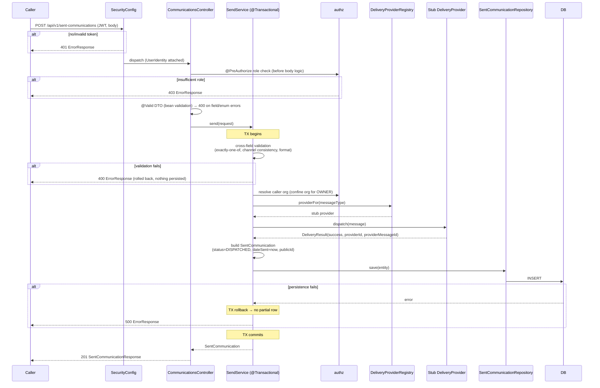

# Design Document

## Overview

This feature adds a **send-and-log** capability to the storage-manager-communications service. A caller invokes `POST /api/v1/sent-communications` with a message to deliver over email or SMS; the service runs the delivery through a provider seam (a **stub/no-op** in this spec that transmits nothing externally and reports success), persists exactly one immutable `SentCommunication` audit entry inside a single transaction, and returns `201` with the persisted entry (including its UUID `id` and generated `publicId`). Two read endpoints retrieve logged communications: `GET /api/v1/sent-communications/{id}` (by id) and `GET /api/v1/sent-communications` (a filterable, paginated, newest-first list).

The design mirrors the conventions already established in this service by the `entity-api`, `communication-template-api`, and `messaging` specs:

- JPA entity with a `GenerationType.UUID` id and `@PrePersist`/`@PreUpdate` `Instant` timestamps (as in `EntityPropertyMapping` and `CommunicationTemplate`).
- `EnumType.STRING` enums stored as their literal name (as in `EntityType`).
- Jakarta Bean Validation request DTO **records**, and response DTO **records** with a static `from(...)` mapper (as in `CreateEntityPropertyMappingRequest` / `EntityPropertyMappingResponse`).
- A single `@Transactional` service (as in `CommunicationService` / `EntityPropertyMappingService`).
- A Spring Data `JpaRepository` with derived-query finders (as in `EntityPropertyMappingRepository`).
- Custom exceptions translated to the standard `ErrorResponse` by the existing `GlobalExceptionHandler`.
- Role-based access via `@PreAuthorize` backed by the `@Service("authz")` `AuthorizationService` bean — reads (GET-by-id and list) are restricted to ADMIN and OWNER (no STAFF), matching the existing template endpoints. Org scoping is enforced in the service layer by comparing the row's own `organizationId` to the caller's JWT org (exactly as `CommunicationService` does for templates): an ADMIN sees all organizations/facilities, while an OWNER is confined to its own organization and receives `403` (`AccessDeniedException`) on a foreign-org by-id read.
- The existing `PagedResponse<T>` list wrapper and `ErrorResponse` record.

**Naming:** the controller is `CommunicationsController` (plural) at `/api/v1/sent-communications`. The root `/api/v1/communications` is already owned by the messaging `InboundEventController` (`POST` event ingest), and `/api/v1/communication-templates` by the singular `CommunicationController`; `/api/v1/sent-communications` is distinct from both, so no routes collide. (All endpoints remain covered by `SecurityConfig`'s `.anyRequest().authenticated()`.)

**Scope:** this design is self-contained to storage-manager-communications. The Delivery_Provider is a stub; no third-party vendor integration is designed here. There is no cross-repository/event-inbox narrative in scope — the upstream event flow is explicitly out of this deliverable.

## Architecture

### Package layout

The feature slots into the existing package structure under `com.storagemanager.communications`:

| Package | New types |
|---|---|
| `model` | `SentCommunication` (entity), `MessageType`, `SendStatus`, `RecipientType` (enums) |
| `dto` | `SendCommunicationRequest` (record), `SentCommunicationResponse` (record) |
| `repository` | `SentCommunicationRepository` |
| `service` | `SendService`, `DeliveryProvider` (interface), `StubEmailDeliveryProvider`, `StubSmsDeliveryProvider`, `DeliveryProviderRegistry` |
| `controller` | `CommunicationsController` |
| `util` | `PublicIdGenerator` (new, mirroring the storage-manager-api utility) |
| `db/migration` | `V5__create_sent_communications.sql` |

Reused as-is: `AuthorizationService` (`authz`), `UserIdentity`, `UserRole`, `PagedResponse`, `ErrorResponse`, `GlobalExceptionHandler`, `EntityNotFoundException`, `SecurityConfig`, `CustomJwtAuthenticationConverter`.

### Component diagram (HLD)

```mermaid
graph TD
    Client[Caller] -->|HTTP + JWT| SC[SecurityConfig<br/>OAuth2 resource server]
    SC -->|UserIdentity on JwtAuthenticationToken| CC[CommunicationsController<br/>/api/v1/sent-communications]
    CC -->|@PreAuthorize @authz...| AZ[AuthorizationService<br/>bean 'authz']
    CC --> SS[SendService<br/>@Transactional]
    SS --> AZ
    SS --> DPR[DeliveryProviderRegistry]
    DPR -->|MessageType.EMAIL| EMAIL[StubEmailDeliveryProvider]
    DPR -->|MessageType.SMS| SMS[StubSmsDeliveryProvider]
    SS --> REPO[SentCommunicationRepository]
    SS --> PIG[PublicIdGenerator]
    REPO --> DB[(sent_communications<br/>table)]
    CC -.errors.-> GEH[GlobalExceptionHandler]
    GEH -.ErrorResponse.-> Client
```

### Send-and-log sequence (write flow)



### Read sequence (by-id and list)

```mermaid
sequenceDiagram
    participant C as Caller
    participant Ctl as CommunicationsController
    participant Svc as SendService
    participant Az as authz
    participant Repo as SentCommunicationRepository

    C->>Ctl: GET /api/v1/sent-communications/{id}  (or list w/ filters)
    Ctl->>Az: @PreAuthorize role check
    alt by id
        Ctl->>Ctl: parse UUID path (malformed → 400)
        Ctl->>Svc: get(id)
        Svc->>Repo: findById(id)
        alt missing
            Svc-->>C: 404 ErrorResponse
        end
        Svc->>Az: admin? else owner org match
        alt owner & org mismatch
            Svc-->>C: 403 ErrorResponse (AccessDeniedException)
        end
        Svc-->>Ctl: SentCommunication
        Ctl-->>C: 200 SentCommunicationResponse
    else list
        Ctl->>Ctl: validate page/size (page>=0, size>=1 else 400; cap 100)
        Ctl->>Ctl: parse facilityId UUID / messageType enum filters (malformed → 400)
        Ctl->>Svc: list(facilityId, messageType, pageable)
        Svc->>Az: admin → all orgs; else confine to caller org
        Svc->>Repo: findBy...OrderByDateSentDescIdDesc(...)
        Repo-->>Svc: Page<SentCommunication>
        Svc-->>Ctl: Page
        Ctl-->>C: 200 PagedResponse (newest-first, deterministic)
    end
```

## Components and Interfaces

### Enums (`model` package)

All three use `@Enumerated(EnumType.STRING)` wherever persisted, matching `EntityType`.

```java
public enum MessageType { EMAIL, SMS }

public enum SendStatus { DISPATCHED }   // only value in this spec; the default

public enum RecipientType { LEAD, OWNER }
```

Referencing these enum types directly on the request DTO and `@RequestParam` means Jackson/Spring binding rejects an unknown string as a readability/type-mismatch `400` via the existing `GlobalExceptionHandler` (`HttpMessageNotReadableException` → field-named 400 for the body; `MethodArgumentTypeMismatchException` → 400 for a query param), exactly as `EntityType` behaves today.

### `SentCommunication` entity (`model` package)

JPA entity mirroring the `EntityPropertyMapping`/`CommunicationTemplate` style: `@Id` with `@GeneratedValue(strategy = GenerationType.UUID)`, explicit `@Column` names, `Instant` timestamps set by `@PrePersist`/`@PreUpdate`. Columns and nullability match Requirement 5 one-for-one (see Data Models for the field↔column table).

Key points:
- `dateSent` is set **once by the service** (not by a lifecycle callback) to the instant the send completed; it is independent of `createdAt`/`updatedAt` which are set by the callbacks.
- `status` field defaults to `SendStatus.DISPATCHED` at the Java level (field initializer) and is `NOT NULL` in the schema.
- `publicId` is `nullable = false, unique = true, length = 64`.
- Exactly-one-of phone/email is **not** expressible as a single-column DB constraint; it is enforced by request validation + service logic and asserted by a property test. (A DB `CHECK` is noted as optional in Data Models but not required.)

### `SendCommunicationRequest` DTO (`dto` package, record)

A Jakarta Bean Validation record. Field-level annotations cover the single-field rules (required, length, enum); the cross-field rules (exactly-one-of, channel/contact consistency, format-for-channel) are enforced in the service so the error messages can name the specific offending condition per Requirement 2.

```java
public record SendCommunicationRequest(
        @NotNull UUID facilityId,
        @NotNull MessageType messageType,
        @NotBlank @Size(min = 1, max = 10000) String messageContent,
        @Size(max = 32)  String phoneNumber,      // nullable; "supplied" = present & non-blank after trim
        @Size(max = 254) String emailAddress,     // nullable; "supplied" = present & non-blank after trim
        @Size(max = 255) String emailSubject,     // nullable
        RecipientType recipientType,              // nullable
        UUID tenantId,                            // nullable
        UUID userId,                              // nullable
        UUID correlationId,                       // nullable
        UUID organizationId                       // nullable in body; confined per role (see SendService)
) {}
```

Notes:
- `@NotNull messageType` yields a 400 naming `messageType` when absent/null; an unknown enum string fails Jackson binding → 400 (Req 2.8).
- `@NotNull facilityId` / `@NotBlank messageContent` cover Req 2.7 (missing required field). `@Size(min=1,max=10000)` on `messageContent` enforces Req 5.4 length at the edge.
- `phoneNumber`/`emailAddress` carry only `@Size` at the field level; presence/exactly-one/format are decided in the service against the trimmed values (Req 2.1–2.6, 2.9).

### `SentCommunicationResponse` DTO (`dto` package, record)

Response record containing every persisted audit field plus `id` and `publicId`, with a static `from(SentCommunication)` mapper (mirrors `EntityPropertyMappingResponse.from`). Returned by all three endpoints (and wrapped in `PagedResponse` for the list).

```java
public record SentCommunicationResponse(
        UUID id, String publicId, UUID facilityId, Instant dateSent,
        String messageContent, MessageType messageType,
        String phoneNumber, String emailAddress, SendStatus status,
        UUID tenantId, UUID userId, UUID organizationId,
        RecipientType recipientType, String emailSubject, UUID correlationId,
        String deliveryProvider, String providerMessageId, String failureReason,
        Instant createdAt, Instant updatedAt
) {
    public static SentCommunicationResponse from(SentCommunication s) { /* field-for-field */ }
}
```

### `SentCommunicationRepository` (`repository` package)

Spring Data `JpaRepository<SentCommunication, UUID>` with derived finders implementing the newest-first, tie-broken-by-id ordering (Req 4.2) and the facility / messageType / org filter combinations (Req 4.3–4.6, 7.5–7.6), plus the publicId-uniqueness pre-check:

```java
public interface SentCommunicationRepository extends JpaRepository<SentCommunication, UUID> {

    boolean existsByPublicId(String publicId);

    // Admin, no filters
    Page<SentCommunication> findAllByOrderByDateSentDescIdDesc(Pageable p);
    // Admin + facility / + messageType / + both
    Page<SentCommunication> findByFacilityIdOrderByDateSentDescIdDesc(UUID facilityId, Pageable p);
    Page<SentCommunication> findByMessageTypeOrderByDateSentDescIdDesc(MessageType type, Pageable p);
    Page<SentCommunication> findByFacilityIdAndMessageTypeOrderByDateSentDescIdDesc(UUID facilityId, MessageType type, Pageable p);

    // OWNER, org-confined variants (organizationId leading)
    Page<SentCommunication> findByOrganizationIdOrderByDateSentDescIdDesc(UUID orgId, Pageable p);
    Page<SentCommunication> findByOrganizationIdAndFacilityIdOrderByDateSentDescIdDesc(UUID orgId, UUID facilityId, Pageable p);
    Page<SentCommunication> findByOrganizationIdAndMessageTypeOrderByDateSentDescIdDesc(UUID orgId, MessageType type, Pageable p);
    Page<SentCommunication> findByOrganizationIdAndFacilityIdAndMessageTypeOrderByDateSentDescIdDesc(UUID orgId, UUID facilityId, MessageType type, Pageable p);
}
```

The `...OrderByDateSentDescIdDesc` suffix encodes the deterministic newest-first ordering with id as a stable tiebreaker. (The `Pageable` carries page/size only; sort is baked into the method name so the DB index on `(facility_id, date_sent)` and the primary key support it.)

### `DeliveryProvider` seam + stubs (`service` package)

The provider seam abstracts third-party delivery and is **selectable per `MessageType`**. In this spec both implementations are no-op stubs that transmit nothing and report success (Req 1.3).

```java
public interface DeliveryProvider {
    MessageType channel();                 // EMAIL or SMS
    DeliveryResult dispatch(DeliveryRequest request);
}

public record DeliveryRequest(
        MessageType messageType, String recipientContact, String messageContent,
        String emailSubject, UUID correlationId) {}

public record DeliveryResult(
        boolean success, String providerId, String providerMessageId, String failureReason) {}
```

- `StubEmailDeliveryProvider` → `channel() == EMAIL`; `dispatch` performs no I/O and returns `new DeliveryResult(true, "stub-email", <generated-id>, null)`.
- `StubSmsDeliveryProvider` → `channel() == SMS`; analogous with `"stub-sms"`.
- `DeliveryProviderRegistry` is a `@Component` that receives all `DeliveryProvider` beans via constructor injection and indexes them by `channel()` into an `EnumMap<MessageType, DeliveryProvider>`, exposing `providerFor(MessageType)`. Selecting a provider for a type with no registered provider is a configuration error (not reachable given both stubs are registered).

This keeps the seam honest: swapping a stub for a real vendor adapter later is a pure addition of a `DeliveryProvider` bean, no `SendService` change.

### `SendService` (`service` package, `@Transactional`)

The single application service. Constructor-injects `SentCommunicationRepository`, `DeliveryProviderRegistry`, and `AuthorizationService authz` (same pattern as `CommunicationService`). Methods:

**`SentCommunication send(SendCommunicationRequest request)`** — `@Transactional` (read-write):
1. **Cross-field validation** (throws `IllegalArgumentException` → 400 via handler):
   - Normalize: treat `phoneNumber`/`emailAddress` as *supplied* only when non-null and non-blank after `strip()`.
   - Exactly-one: neither supplied → 400 "exactly one recipient contact is required" (Req 2.1); both supplied → 400 "only one recipient contact may be supplied" (Req 2.2).
   - Channel consistency: `EMAIL` with phone-only → 400 (Req 2.5); `SMS` with email-only → 400 (Req 2.6).
   - Format: for `EMAIL`, the supplied email must match an email syntax check; for `SMS`, the supplied phone must match a phone syntax check; else 400 naming the field (Req 2.9).
2. **Org resolution / confinement** (via `authz.getCurrentUserIdentity()`): ADMIN may supply `organizationId` (required if admin and used as-is); an OWNER caller's persisted `organizationId` is **forced** to the token org, ignoring/validating any supplied value (Req 7.8), mirroring `CommunicationService.create`.
3. **Dispatch**: `registry.providerFor(messageType).dispatch(...)` **exactly once** (Req 1.2). Stub returns success (Req 1.3).
4. **Persist exactly one entity**: build `SentCommunication`, set `status = DISPATCHED` (Req 1.4), `dateSent = Instant.now()` captured once at completion (Req 1.6), the single recipient contact (other left null, Req 1.5), `publicId` from `PublicIdGenerator` with uniqueness retry, `deliveryProvider`/`providerMessageId` from the `DeliveryResult`. `repository.save(entity)` — the whole method is one transaction, so a persistence failure rolls back and no partial row remains; the surfaced error maps to 500 (Req 1.8).

**`SentCommunication get(UUID id)`** — `@Transactional(readOnly = true)`: `findById` → `EntityNotFoundException` (404) if absent (Req 3.3). If the caller is an OWNER and the row's `organizationId != token org`, throw `AccessDeniedException` (**403**) per Req 3.4/7.7 — mirroring `CommunicationService.get` for templates exactly (missing → 404 first, then the org match → 403). ADMIN reads any row (Req 3.2, 7.6).

**`Page<SentCommunication> list(UUID facilityId, MessageType messageType, Pageable pageable)`** — `@Transactional(readOnly = true)`: resolve the caller role from `authz`; ADMIN uses the non-org-scoped finders (across orgs, Req 4.6/7.6), an OWNER uses the `organizationId`-leading finders confined to the token org (Req 4.5, 7.5). Dispatch to the correct finder based on which of `facilityId` / `messageType` are non-null.

### `PublicIdGenerator` (`util` package)

New utility mirroring `storage-manager-api`'s `PublicIdGenerator` (there is no existing public-id convention inside storage-manager-communications; the service does not own organization/facility public ids). It generates an 8-char alphanumeric string from a `SecureRandom` over `[A-Za-z0-9]`. The service calls it inside a bounded retry loop (`existsByPublicId` pre-check, up to 5 attempts), throwing a 500-mapped error if a unique value cannot be produced — the same shape storage-manager-api uses. The 8-char value fits comfortably within the `<=64` column.

> **Noted decision:** publicId format follows the storage-manager-api convention (8-char `[A-Za-z0-9]`, `SecureRandom`), relocated into this service as a local `util.PublicIdGenerator` since the convention is not otherwise present here. The column is sized 64 to leave room for a future prefixed scheme without a migration.

### `CommunicationsController` (`controller` package)

`@RestController` mirroring `EntityPropertyMappingController`/`CommunicationController`. Every endpoint carries a `@PreAuthorize("@authz...")` gate so the role check runs before any business logic (Req 7.3); authentication (401) is enforced upstream by `SecurityConfig` (`anyRequest().authenticated()` + `CustomAuthenticationEntryPoint`).

```java
@RestController
public class CommunicationsController {

    private final SendService service;

    @PostMapping("/api/v1/sent-communications")
    @ResponseStatus(HttpStatus.CREATED)
    @PreAuthorize("@authz.isAdmin() or @authz.hasRole('OWNER')")
    public SentCommunicationResponse send(@Valid @RequestBody SendCommunicationRequest request) {
        return SentCommunicationResponse.from(service.send(request));
    }

    @GetMapping("/api/v1/sent-communications/{id}")
    @PreAuthorize("@authz.isAdmin() or @authz.hasRole('OWNER')")
    public SentCommunicationResponse get(@PathVariable UUID id) {
        return SentCommunicationResponse.from(service.get(id));
    }

    @GetMapping("/api/v1/sent-communications")
    @PreAuthorize("@authz.isAdmin() or @authz.hasRole('OWNER')")
    public PagedResponse<SentCommunicationResponse> list(
            @RequestParam(required = false) UUID facilityId,
            @RequestParam(required = false) MessageType messageType,
            @RequestParam(defaultValue = "0") int page,
            @RequestParam(defaultValue = "20") int size) {
        if (page < 0) throw new IllegalArgumentException("page must be >= 0");
        if (size < 1) throw new IllegalArgumentException("size must be >= 1");
        int cappedSize = Math.min(size, 100);
        Pageable pageable = PageRequest.of(page, cappedSize);
        return PagedResponse.from(
                service.list(facilityId, messageType, pageable)
                        .map(SentCommunicationResponse::from));
    }
}
```

- Page defaults 0 / size 20, cap 100, page<0 / size<1 → 400 — identical to the existing controllers (Req 4.7–4.10).
- `@PathVariable UUID id` → a non-UUID path yields `MethodArgumentTypeMismatchException` → 400 (Req 3.5). `@RequestParam UUID facilityId` / `MessageType messageType` → malformed filter → 400 (Req 4.12, 4.13).
- Roles: this spec grants send+read to **ADMIN and OWNER only** (no STAFF), matching the existing `CommunicationController` template endpoints (`@authz.isAdmin() or @authz.hasRole('OWNER')`). ADMIN is the organization-scope-bypass role; an OWNER is confined to its own organization (that is, its own facilities), with the authoritative org match enforced in the service layer exactly as `CommunicationService` does for templates.

### Validation approach summary

| Rule | Where | Maps to |
|---|---|---|
| required facilityId / messageType / messageContent | DTO `@NotNull`/`@NotBlank` | `MethodArgumentNotValidException` → 400 (Req 2.7) |
| messageContent length 1–10000 | DTO `@Size` | 400 (Req 5.4) |
| phone ≤32 / email ≤254 / subject ≤255 | DTO `@Size` | 400 |
| invalid messageType enum (body) | Jackson binding | `HttpMessageNotReadableException` → 400 (Req 2.8) |
| invalid messageType enum (list filter) | Spring param binding | `MethodArgumentTypeMismatchException` → 400 (Req 4.12) |
| invalid facilityId UUID (path/filter) | Spring param binding | `MethodArgumentTypeMismatchException` → 400 (Req 3.5, 4.13) |
| exactly-one-of phone/email | `SendService` | `IllegalArgumentException` → 400 (Req 2.1–2.4) |
| channel/contact consistency | `SendService` | `IllegalArgumentException` → 400 (Req 2.5, 2.6) |
| contact format for channel | `SendService` | `IllegalArgumentException` → 400 (Req 2.9) |

## Data Models

### Entity ↔ table/column mapping

The entity field designations below are the authoritative source for the `V5` DDL; `ddl-auto=validate` requires an exact match (Req 6.3).

| Entity field | Java type | Column | SQL type | Null | Source (Req 5) |
|---|---|---|---|---|---|
| `id` | `UUID` (`@GeneratedValue UUID`) | `id` | `UUID` PK | NOT NULL | 5.1 |
| `publicId` | `String` | `public_id` | `VARCHAR(64)` UNIQUE | NOT NULL | 5.12 |
| `facilityId` | `UUID` | `facility_id` | `UUID` | NOT NULL | 5.2 |
| `dateSent` | `Instant` | `date_sent` | `TIMESTAMP WITH TIME ZONE` | NOT NULL | 5.3 |
| `messageContent` | `String` | `message_content` | `VARCHAR(10000)` | NOT NULL | 5.4 |
| `messageType` | `MessageType` (STRING) | `message_type` | `VARCHAR(16)` | NOT NULL | 5.5 |
| `phoneNumber` | `String` | `phone_number` | `VARCHAR(32)` | nullable | 5.6 |
| `emailAddress` | `String` | `email_address` | `VARCHAR(254)` | nullable | 5.7 |
| `status` | `SendStatus` (STRING) | `status` | `VARCHAR(32)` | NOT NULL | 5.9 |
| `tenantId` | `UUID` | `tenant_id` | `UUID` | nullable | 5.10 |
| `userId` | `UUID` | `user_id` | `UUID` | nullable | 5.11 |
| `organizationId` | `UUID` | `organization_id` | `UUID` | NOT NULL | 5.13 |
| `recipientType` | `RecipientType` (STRING) | `recipient_type` | `VARCHAR(16)` | nullable | 5.14 |
| `emailSubject` | `String` | `email_subject` | `VARCHAR(255)` | nullable | 5.15 |
| `correlationId` | `UUID` | `correlation_id` | `UUID` | nullable | 5.16 |
| `deliveryProvider` | `String` | `delivery_provider` | `VARCHAR(64)` | nullable | 5.17 |
| `providerMessageId` | `String` | `provider_message_id` | `VARCHAR(255)` | nullable | 5.18 |
| `failureReason` | `String` | `failure_reason` | `VARCHAR(1000)` | nullable | 5.19 |
| `createdAt` | `Instant` (`@PrePersist`) | `created_at` | `TIMESTAMP WITH TIME ZONE` | NOT NULL, not updatable | 5.20 |
| `updatedAt` | `Instant` (`@PreUpdate`) | `updated_at` | `TIMESTAMP WITH TIME ZONE` | NOT NULL | 5.20, 5.21 |

The `exactly-one-of phone/email` rule (5.8) is enforced at validation/service time, not by a NOT NULL designation (both columns are nullable so either may be the populated one).

### V5 Flyway migration

`V5__create_sent_communications.sql` continues the linear history immediately after `V4` (Req 6.1). It declares one column per entity field with matching nullability, `id` as the primary key, a unique constraint on `public_id` (Req 6.2, 5.12), and the `(facility_id, date_sent DESC)` index supporting the newest-first facility-filtered list query (Req 6.4). Types use `UUID`/`VARCHAR`/`TIMESTAMP WITH TIME ZONE`, which run identically under PostgreSQL (prod) and H2 PostgreSQL mode (tests), matching the V1/V3 convention.

```sql
-- V5__create_sent_communications.sql
-- Creates the sent_communications table backing the send-and-log (Communications API) feature,
-- continuing this service's linear Flyway history after V1 (communication_templates),
-- V2 (messaging_inbox_outbox), V3 (entity_property_mappings), and
-- V4 (add entity_type to communication_templates).
--
-- Each row is one immutable audit entry of a communication the service dispatched. Column
-- nullability matches the SentCommunication entity field designations (Requirement 5) one-for-one
-- so Hibernate ddl-auto=validate passes; a mismatch fails application start.
--
-- Exactly-one-of phone_number/email_address is a request/service invariant (Req 5.8), not a column
-- constraint, so both contact columns are nullable.

CREATE TABLE sent_communications (
    id                   UUID PRIMARY KEY,
    public_id            VARCHAR(64) NOT NULL,
    facility_id          UUID NOT NULL,
    date_sent            TIMESTAMP WITH TIME ZONE NOT NULL,
    message_content      VARCHAR(10000) NOT NULL,
    message_type         VARCHAR(16) NOT NULL,
    phone_number         VARCHAR(32),
    email_address        VARCHAR(254),
    status               VARCHAR(32) NOT NULL,
    tenant_id            UUID,
    user_id              UUID,
    organization_id      UUID NOT NULL,
    recipient_type       VARCHAR(16),
    email_subject        VARCHAR(255),
    correlation_id       UUID,
    delivery_provider    VARCHAR(64),
    provider_message_id  VARCHAR(255),
    failure_reason       VARCHAR(1000),
    created_at           TIMESTAMP WITH TIME ZONE NOT NULL,
    updated_at           TIMESTAMP WITH TIME ZONE NOT NULL,
    CONSTRAINT uq_sent_comm_public_id UNIQUE (public_id)
);

-- Supports the newest-first, facility-filtered list query (Requirement 4.1/4.2):
-- facility_id leading for the filter, date_sent DESC for the ordering.
CREATE INDEX idx_sent_comm_facility_date_sent
    ON sent_communications (facility_id, date_sent DESC);
```

## Correctness Properties

*A property is a characteristic or behavior that should hold true across all valid executions of a system — essentially, a formal statement about what the system should do. Properties serve as the bridge between human-readable specifications and machine-verifiable correctness guarantees.*

The following properties are derived from the acceptance-criteria prework. Redundant criteria were consolidated: the many "what a successful send produces" clauses (1.2, 1.4, 1.5, 1.7, 5.1, 5.9, 5.20/5.21) collapse into Property 1; the headline exactly-one-of invariant (5.8, accept side of 2.3/2.4) is kept as its own Property 2; the rejection clauses (2.1, 2.2, 2.5, 2.6, 2.9) collapse into Property 4; and the visibility/filter clauses (4.3–4.6, 7.5–7.7, 3.4) collapse into Properties 6 and 7. Criteria that are routing/config facts (1.1, 6.1–6.4), deterministic single-scenario behaviors (1.3, 1.8, 2.7, 2.8, 3.1, 3.3, 3.5, 4.1, 4.7, 4.8, 4.10–4.13, 7.1–7.4, 8.1, 8.3–8.6) are covered by example/edge/integration/smoke tests in the Testing Strategy, not by properties.

### Property 1: A successful send persists exactly one well-formed audit entry

*For any* valid send request (either channel, with the single channel-matching contact and arbitrary optional fields), performing the send SHALL invoke the Delivery_Provider for that `messageType` exactly once, persist exactly one `SentCommunication`, and that persisted entry SHALL have: `status == DISPATCHED`; `facilityId`, `messageContent`, and `messageType` equal to the request; the channel-matching recipient contact equal to the supplied value with the other contact null; a non-null UUID `id`, a non-null `publicId` of length ≤ 64, and non-null `createdAt`/`updatedAt` set independently of `dateSent`; and `dateSent` non-null and no later than an instant observed after the send returns. Re-fetching by the returned `id` SHALL return an entry whose fields equal the persisted ones (send→get round-trip).

**Validates: Requirements 1.2, 1.4, 1.5, 1.6, 1.7, 2.3, 2.4, 3.2, 5.1, 5.2, 5.3, 5.4, 5.5, 5.9, 5.12, 5.20, 5.21**

### Property 2: Exactly-one-of phone/email invariant

*For any* accepted send request, the persisted `SentCommunication` SHALL have exactly one of `phoneNumber` / `emailAddress` non-null, and the non-null one SHALL be the contact matching the `messageType` (`EMAIL` → `emailAddress`, `SMS` → `phoneNumber`).

**Validates: Requirements 2.3, 2.4, 5.8, 1.5**

### Property 3: Generated publicId is unique

*For any* sequence of successful sends, every persisted `publicId` SHALL be non-null, of length ≤ 64, and pairwise distinct across the sequence.

**Validates: Requirements 5.12**

### Property 4: Invalid recipient-contact requests are rejected and persist nothing

*For any* send request that supplies neither contact (each treated as absent when null or blank-after-trim), supplies both contacts, supplies a contact that does not match its `messageType` channel, or supplies a channel-matching contact whose format is malformed, the service SHALL reject the request with HTTP 400 and SHALL persist no `SentCommunication`.

**Validates: Requirements 2.1, 2.2, 2.5, 2.6, 2.9**

### Property 5: List ordering is newest-first and deterministic

*For any* set of persisted `SentCommunication` entries visible to the caller, the list result SHALL be ordered by `dateSent` descending, breaking ties between equal `dateSent` values by `id`, and SHALL produce the same ordering on repeated identical calls.

**Validates: Requirements 4.2**

### Property 6: List is sound, complete, and org-scoped

*For any* set of persisted entries, filters (`facilityId` and/or `messageType`), and caller holding ADMIN or OWNER, the list result SHALL contain exactly those entries that match every supplied filter AND are within the caller's visibility scope — where an OWNER caller's scope is their own organization and an ADMIN caller's scope is all organizations — with no in-scope matching entry omitted and no out-of-scope or non-matching entry included.

**Validates: Requirements 4.3, 4.4, 4.5, 4.6, 7.5, 7.6**

### Property 7: By-id visibility respects organization scope

*For any* persisted entry and any caller holding ADMIN or OWNER, retrieval by id SHALL return the entry when the caller is an ADMIN or when the caller is an OWNER whose organization equals the entry's `organizationId`, and SHALL respond with HTTP 403 (`AccessDeniedException`) when an OWNER caller's organization differs from the entry's `organizationId`.

**Validates: Requirements 3.4, 7.7**

### Property 8: Applied page size is capped

*For any* requested page size ≥ 1, the applied page size SHALL equal the smaller of the requested size and 100.

**Validates: Requirements 4.9**

### Property 9: OWNER send confines organization to the caller's org

*For any* OWNER caller and any supplied `organizationId` in the request, the persisted `SentCommunication`'s `organizationId` SHALL equal the caller's token organization.

**Validates: Requirements 7.8**

### Property 10: Error responses are well-formed

*For any* request that produces an error (400, 401, 403, 404, or 500), the response body SHALL be an `ErrorResponse` whose `timestamp`, `status`, `error`, and `message` fields are all non-null and whose `status` field equals the HTTP status code of the response.

**Validates: Requirements 8.2**

## Error Handling

All error translation reuses the existing `GlobalExceptionHandler`; no new handler methods are required because the feature's errors map onto exceptions the handler already covers.

| Condition | Exception / mechanism | HTTP | Requirement |
|---|---|---|---|
| Missing/blank required field, bad `@Size` | `MethodArgumentNotValidException` | 400 | 2.7, 5.4 |
| Unknown `messageType` enum in body | `HttpMessageNotReadableException` (`InvalidFormatException`) | 400 | 2.8 |
| Non-UUID path id, bad filter UUID/enum | `MethodArgumentTypeMismatchException` | 400 | 3.5, 4.12, 4.13 |
| Exactly-one-of / channel / format violation | `IllegalArgumentException` (from `SendService`) | 400 | 2.1, 2.2, 2.5, 2.6, 2.9 |
| page<0 / size<1 | `IllegalArgumentException` (from controller) | 400 | 4.10 |
| Entry missing | `EntityNotFoundException` | 404 | 3.3 |
| No/invalid token | `AuthenticationException` → `CustomAuthenticationEntryPoint` | 401 | 7.1 |
| Insufficient role; OWNER by-id out-of-org | `AccessDeniedException` → `CustomAccessDeniedHandler` | 403 | 7.2, 3.4, 7.7 |
| publicId generation exhausted; persistence failure after dispatch | `RuntimeException` (unique-id exhaustion) / propagated persistence exception; `@Transactional` rollback | 500 | 1.8 |

Key behaviors:
- **Out-of-org by-id → 403:** the by-id org-scope miss for an OWNER throws `AccessDeniedException` (403), mirroring `CommunicationService.get` for templates and the other API methods in this component. Lookup happens first (missing id → 404), then the org match (foreign org → 403), consistent with Req 3.3 and 3.4/7.7.
- **Reads restricted to ADMIN/OWNER:** the GET-by-id and list endpoints are gated to ADMIN and OWNER only (no STAFF), matching the existing `CommunicationController` template endpoints (Req 3.1, 4.1, 7.4).
- **Authorization before business logic:** `@PreAuthorize` on every method means a disallowed role is rejected 403 before the service runs, even for a nonexistent id (Req 7.3).
- **Transactional rollback:** `send` is a single `@Transactional` method; a persistence failure after the (stub) dispatch rolls the whole transaction back, leaving no partial row, and surfaces as a 500 `ErrorResponse` via the handler's catch-all (Req 1.8).
- **Error shape:** every error flows through `GlobalExceptionHandler.buildResponse`, which populates all four `ErrorResponse` fields and sets `status` to the HTTP code (Req 8.1, 8.2).

## Testing Strategy

The service already uses **jqwik** (`net.jqwik:jqwik` + `jqwik-spring`, version `1.8.5`, test scope — see `pom.xml`) with a `.jqwik-database` present, and existing property tests under `src/test/java/.../property` (e.g. `EntityMappingRoundTripPropertyTest`) establish the pattern: a `@Property(tries = 100)` method with `@Provide` arbitraries and an in-memory **Mockito-backed fake repository** that mimics `@PrePersist` by assigning id/timestamps on `save`. This feature follows that exact approach.

### Dual approach

- **Property-based tests (jqwik):** one `@Property(tries = 100)` test per correctness property (Properties 1–10). Each is tagged with a comment in the format **`Feature: communications-api, Property {n}: {property text}`** and references the validated requirements. Generators cover both channels, blank/absent/both/malformed contacts, varied optional fields, equal-`dateSent` ties, multiple orgs/facilities, and ADMIN vs OWNER callers. The service is driven against a Mockito-fake `SentCommunicationRepository` (and a counting stub `DeliveryProvider`) so properties test the `SendService` logic in isolation at 100+ iterations without a database.
- **Example / edge-case unit tests:** the deterministic single-scenario criteria — stub reports success and does no I/O (1.3), rollback→500 (1.8), missing-field 400 (2.7), unknown-enum 400 (2.8), unknown-id 404 (3.3), non-UUID id 400 (3.5), default page 0 / size 20 (4.7/4.8), page<0/size<1 400 (4.10), empty PagedResponse shape (4.11), invalid filter 400 (4.12/4.13), ADMIN/OWNER-only reads (3.1/4.1/7.4), and `@PreAuthorize`-before-logic 403 (7.3).
- **Integration / smoke tests:**
  - A Spring Boot context + Flyway test running against **H2 in PostgreSQL mode** (as the existing migration smoke tests do) with `ddl-auto=validate` to prove the `SentCommunication` mapping matches the `V5` schema and the app starts (Req 6.3); a `V5` migration smoke test asserting the table, columns, nullability, `public_id` unique constraint, and `(facility_id, date_sent)` index exist and that `V5` is the latest migration (Req 6.1, 6.2, 6.4).
  - A persistence integration test (`@DataJpaTest`-style, matching `EntityPropertyMappingPersistenceIT`) that round-trips a `SentCommunication` through the real repository to confirm column lengths/nullability behave as mapped.
  - MockMvc security tests for 401 (no token), 403 (disallowed role), and the standard `ErrorResponse` shape (Req 7.1, 7.2, 8.1).

### Property-based test configuration

- Minimum **100 iterations** per property test (`@Property(tries = 100)`), consistent with existing tests.
- Each property test comment references its design property and validated requirements, e.g.:

```java
/**
 * Feature: communications-api, Property 2: Exactly-one-of phone/email invariant.
 * For any accepted send, the persisted row has exactly one of phoneNumber/emailAddress
 * non-null, matching the messageType channel.
 * Validates: Requirements 2.3, 2.4, 5.8, 1.5
 */
@Property(tries = 100)
void acceptedSend_persistsExactlyOneChannelMatchingContact(@ForAll("validSendRequests") SendCommunicationRequest req) { ... }
```

- A property-based testing library is **not** reimplemented; jqwik (already a dependency) is used.
- Each correctness property is implemented by a **single** property-based test.

### Coverage mapping (summary)

| Property | Test | Requirements |
|---|---|---|
| P1 | `send persists one well-formed entry` (PBT) | 1.2, 1.4–1.7, 2.3, 2.4, 3.2, 5.1–5.5, 5.9, 5.12, 5.20, 5.21 |
| P2 | `exactly-one-of phone/email` (PBT) | 2.3, 2.4, 5.8, 1.5 |
| P3 | `publicId uniqueness` (PBT) | 5.12 |
| P4 | `invalid-contact rejection` (PBT) | 2.1, 2.2, 2.5, 2.6, 2.9 |
| P5 | `list ordering determinism` (PBT) | 4.2 |
| P6 | `list filtering + org scoping` (PBT) | 4.3, 4.4, 4.5, 4.6, 7.5, 7.6 |
| P7 | `by-id org-scope visibility (OWNER foreign org → 403)` (PBT) | 3.4, 7.7 |
| P8 | `page size cap` (PBT) | 4.9 |
| P9 | `OWNER send org confinement` (PBT) | 7.8 |
| P10 | `ErrorResponse shape` (PBT) | 8.2 |
| Example/edge | unit tests | 1.3, 1.8, 2.7, 2.8, 3.1, 3.3, 3.5, 4.1, 4.7, 4.8, 4.10–4.13, 7.3, 7.4 |
| Integration/smoke | context/migration/security tests | 1.1, 6.1–6.4, 7.1, 7.2, 8.1, 8.3–8.6 |
