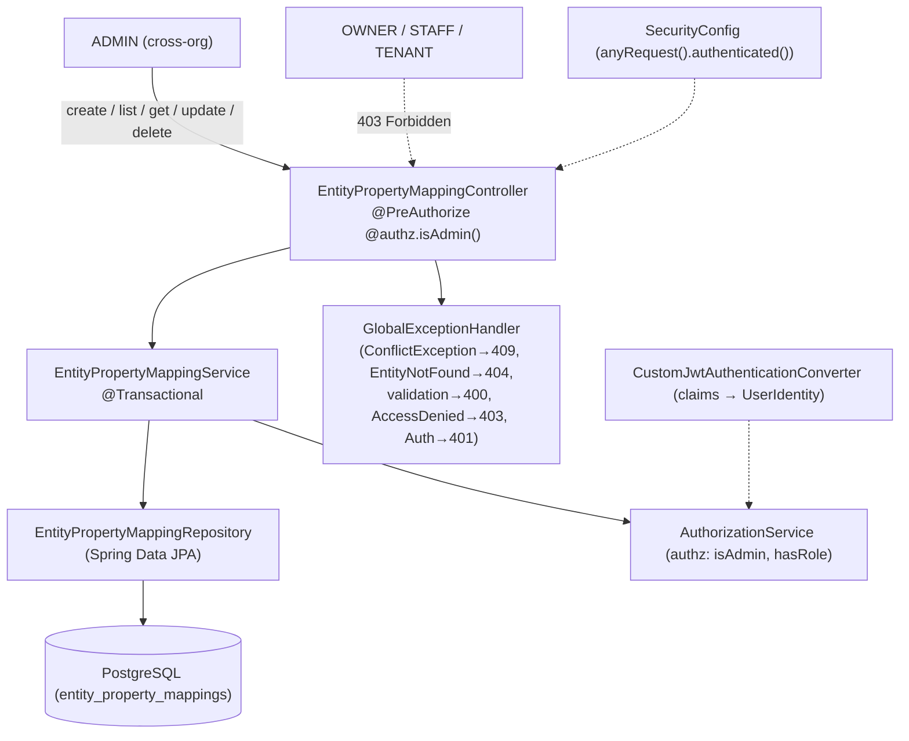
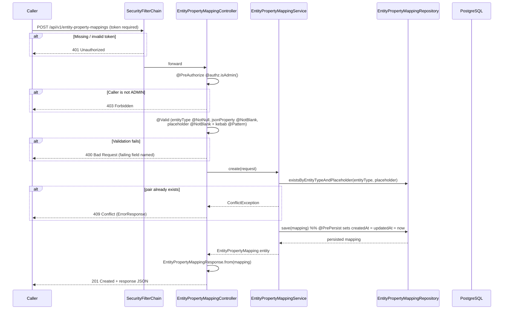
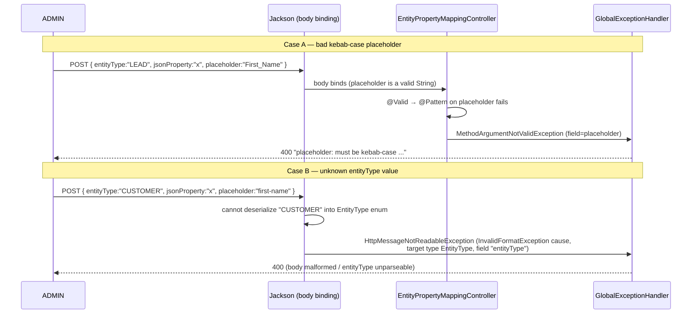
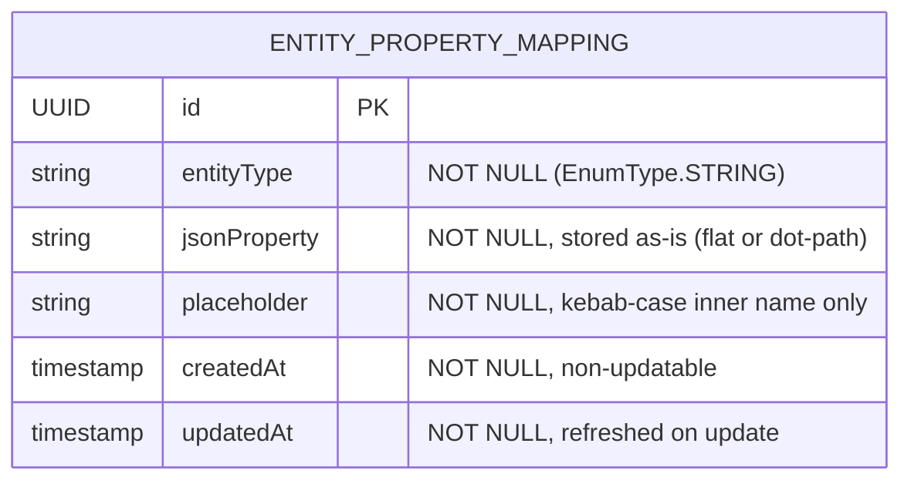

# Design Document: Entity Property Mapping API

## Overview

The Entity Property Mapping API is a DB-backed CRUD feature of the **storage-manager-communications** service. An **Entity Property Mapping** is a single row that translates a JSON property on an upstream domain entity (identified by an `EntityType`) into a kebab-case **placeholder** name used later for template personalization — for example, `(LEAD, firstName) → first-name`, which a template author later references as `{{first-name}}`.

**Scope boundary (narrow and deliberate).** This spec affects **only** `storage-manager-communications`. It introduces the `entity_property_mappings` table and its CRUD API — nothing else. It does **not**:

- render templates or perform placeholder substitution,
- call, read, or validate against any upstream service (the Lead endpoint lives in `storage-manager-api`),
- interpret, traverse, or validate `jsonProperty` against a real upstream shape,
- add any routing, gateway, or service-to-service wiring beyond exposing the CRUD endpoints.

Everything that touches another repository is an **External Assumption** (A1–A4 in the requirements), not a design element implemented here. No code or changes are introduced in `storage-manager-api`, `storage-manager-events`, or any other component.

**Consistency over novelty.** The design intentionally mirrors the existing **communication-api** feature in this same service. It reuses the identical layering, lifecycle-timestamp approach, DTO-record style, `@Transactional` service, Spring Data repository, `PagedResponse<T>` wrapper, `ConflictException`, `GlobalExceptionHandler`/`ErrorResponse` conventions, Flyway linear history, and `@PreAuthorize` role-gating backed by the `authz` (`AuthorizationService`) bean. The one deliberate difference is a **stricter authorization posture**: every endpoint is **ADMIN-only** (communication-api admitted ADMIN *or* OWNER).

The feature adds an `EntityPropertyMappingController` exposing five operations under `/api/v1/entity-property-mappings` (resolving Open Decision D1 to the service's `/api/v1/*` kebab-case plural-noun convention):

1. **Create** (`POST`) — ADMIN only; `201 Created` with body.
2. **List** (`GET`, paginated, optional `entityType` filter) — ADMIN only; `200 OK`.
3. **Get by id** (`GET /{id}`) — ADMIN only; `200 OK`.
4. **Partial update** (`PATCH /{id}`) — ADMIN only; `200 OK`.
5. **Delete** (`DELETE /{id}`) — ADMIN only; `204 No Content` (resolving Open Decision D2).

Each mapping's `(entityType, placeholder)` pair is unique — enforced both by a database unique constraint and by a service-level pre-check that raises a clean `ConflictException` → `409`. Uniqueness is **not** enforced on `jsonProperty`; many placeholders MAY source the same property.

Package root: `com.storagemanager.communications` (same as communication-api).

---

## Architecture

Unlike communication-api, this feature has **no organization/facility scoping** and **no OWNER access path**. The role gate is a flat ADMIN-only `@PreAuthorize` on every endpoint; the service holds only CRUD, partial-update, and uniqueness logic — no data-dependent authorization. There is no `OrganizationRepository`/`FacilityRepository` collaborator (those tables are not owned by this service), and the service injects only its repository.



### Layered Architecture

| Layer | Class | Responsibility |
|---|---|---|
| Controller | `EntityPropertyMappingController` | HTTP routing; `@Valid` request validation; flat ADMIN-only `@PreAuthorize` gate; `page`/`size` validation + capping at 100; optional `entityType` filter param binding; response mapping; correct status codes (`201`/`200`/`204`) |
| Service | `EntityPropertyMappingService` | `@Transactional` business logic: create, list (filtered + unfiltered, newest-first), getById, partial update (null-field preservation), delete; service-level `(entityType, placeholder)` uniqueness pre-check raising `ConflictException`; `EntityNotFoundException` on missing id |
| Repository | `EntityPropertyMappingRepository` | Data access: paginated finders with/without `entityType` filter ordered by `createdAt` DESC; existence-by-pair query for the uniqueness pre-check |
| Security | `SecurityConfig` + `CustomJwtAuthenticationConverter` | All `/api/v1/entity-property-mappings*` paths fall under `anyRequest().authenticated()` (no `permitAll` added); `CustomJwtAuthenticationConverter` derives `UserIdentity` (role) from JWT claims and rejects a missing/unrecognized role claim with `401` |

The `AuthorizationService` is used only for the declarative `@authz.isAdmin()` gate; there is no `getCurrentUserIdentity()`/org-scoping logic in this feature's service because mappings are global (not org-scoped).

### Request Lifecycle — Create (with uniqueness check and 409 path)



### Request Lifecycle — Validation 400 paths (kebab-case placeholder and unknown entityType)

The two 400 validation paths resolve by **different mechanisms**, both already mapped by `GlobalExceptionHandler`:



**Why unknown `entityType` surfaces as `HttpMessageNotReadableException`.** When Jackson encounters a JSON string that is not a valid `EntityType` constant while binding the `@RequestBody`, it raises an `InvalidFormatException` (a subclass of `JsonMappingException`). Spring's `RequestResponseBodyMethodProcessor` wraps that in an `HttpMessageNotReadableException` **before** the controller body or Bean Validation runs — so the failure is a body-readability failure, not a `MethodArgumentNotValidException`. The existing `GlobalExceptionHandler.handleHttpMessageNotReadable` maps it to `400` (Requirements 2.4, 5.5, 8.6). The exception's cause carries the target type (`EntityType`) and the offending path (`entityType`); the handler message can be refined to name the `entityType` field by inspecting `InvalidFormatException#getPathReference()` / `getTargetType().isEnum()` — see Error Handling. For the **list query parameter** case (`?entityType=CUSTOMER`), binding fails as a `MethodArgumentTypeMismatchException` instead, which the handler already maps to `400 "Invalid value for parameter 'entityType'"` (Requirement 6.5).

---

## Components and Interfaces

This section is the Low-Level Design (LLD): concrete Java types, DTOs, service/repository/controller contracts, and the status-code mapping.

### `EntityType` enum

A controlled enumeration of upstream entity types. In this spec it defines **exactly one** value, `LEAD` (Requirements 2.1, 2.2). Additional values may be added later as a pure code change; nothing here is keyed off the cardinality.

```java
package com.storagemanager.communications.model;

public enum EntityType {
    LEAD
}
```

> Persisted via `@Enumerated(EnumType.STRING)` so the stored column holds the literal name `LEAD` (Requirement 2.3). Both the entity field and the request/response DTOs reference this type directly, so Jackson handles string↔enum binding and an unknown string fails as described above (Requirement 2.4).

### JPA Entity: `EntityPropertyMapping`



```java
package com.storagemanager.communications.model;

import java.time.Instant;
import java.util.UUID;

import jakarta.persistence.Column;
import jakarta.persistence.Entity;
import jakarta.persistence.EnumType;
import jakarta.persistence.Enumerated;
import jakarta.persistence.GeneratedValue;
import jakarta.persistence.GenerationType;
import jakarta.persistence.Id;
import jakarta.persistence.PrePersist;
import jakarta.persistence.PreUpdate;
import jakarta.persistence.Table;
import jakarta.persistence.UniqueConstraint;

@Entity
@Table(
    name = "entity_property_mappings",
    uniqueConstraints = @UniqueConstraint(
        name = "uq_entity_prop_mapping_type_placeholder",
        columnNames = {"entity_type", "placeholder"}
    )
)
public class EntityPropertyMapping {

    @Id
    @GeneratedValue(strategy = GenerationType.UUID)
    private UUID id;

    @Enumerated(EnumType.STRING)
    @Column(name = "entity_type", nullable = false)
    private EntityType entityType;

    @Column(name = "json_property", nullable = false)
    private String jsonProperty;

    @Column(name = "placeholder", nullable = false)
    private String placeholder;

    @Column(name = "created_at", nullable = false, updatable = false)
    private Instant createdAt;

    @Column(name = "updated_at", nullable = false)
    private Instant updatedAt;

    @PrePersist
    protected void onCreate() {
        Instant now = Instant.now();
        this.createdAt = now;
        this.updatedAt = now;
    }

    @PreUpdate
    protected void onUpdate() {
        this.updatedAt = Instant.now();
    }

    // getters / setters ...
}
```

> `id` uses `GenerationType.UUID` so the provider assigns the primary key (Requirement 1.2). `entityType` is `@Enumerated(EnumType.STRING)` NOT NULL (Requirements 1.3, 2.3). `jsonProperty` is a NOT NULL String stored as supplied — no interpretation, traversal, or dot-path validation (Requirements 1.4, 4.4, 14.2, 14.3). `placeholder` is a NOT NULL String holding the inner name only, without `{{`/`}}` (Requirements 1.5, 11.2). `createdAt` is NOT NULL and non-updatable, set once in `@PrePersist`; `updatedAt` is NOT NULL, set in `@PrePersist` and refreshed in `@PreUpdate` (Requirements 1.6, 1.7). The table-level `@UniqueConstraint` declares the `(entity_type, placeholder)` guarantee (Requirements 1.8, 12.4); there is deliberately **no** unique constraint on `json_property` (Requirements 1.9, 12.2).

### Request DTOs

**`CreateEntityPropertyMappingRequest`** — all three fields required. Kebab-case is enforced on `placeholder` with `@Pattern`; `entityType` requiredness/validity is handled by `@NotNull` plus Jackson enum binding:

```java
package com.storagemanager.communications.dto;

import com.storagemanager.communications.model.EntityType;

import jakarta.validation.constraints.NotBlank;
import jakarta.validation.constraints.NotNull;
import jakarta.validation.constraints.Pattern;

public record CreateEntityPropertyMappingRequest(
        @NotNull EntityType entityType,
        @NotBlank String jsonProperty,
        @NotBlank
        @Pattern(
            regexp = "^[a-z0-9]+(-[a-z0-9]+)*$",
            message = "must be kebab-case (lowercase alphanumeric segments separated by single hyphens)"
        )
        String placeholder
) {}
```

> `@NotNull` on `entityType` yields `400` naming `entityType` when the JSON field is absent/explicitly null (Requirements 5.1, 5.6). When the JSON supplies a **non-enum string** (e.g. `"CUSTOMER"`), binding fails at Jackson as `HttpMessageNotReadableException` → `400` **before** `@Valid` runs (Requirements 2.4, 5.5). `@NotBlank` on `jsonProperty` and `placeholder` yields `400` naming the blank field (Requirements 5.2, 5.3, 5.6). `@Pattern` on `placeholder` with the Kebab_Case_Pattern `^[a-z0-9]+(-[a-z0-9]+)*$` yields `400` naming `placeholder` when the value is non-blank but not kebab-case (Requirements 5.4, 11.1, 11.3). A fully malformed body is handled by the `HttpMessageNotReadableException` handler → `400` (Requirement 5.7).

**`UpdateEntityPropertyMappingRequest`** — every field optional (nullable) for PATCH semantics. A `null` field means "leave unchanged", so `jsonProperty` must not use `@NotBlank`; `placeholder` is validated by `@Pattern` only when present (`@Pattern` passes on `null`):

```java
package com.storagemanager.communications.dto;

import com.storagemanager.communications.model.EntityType;

import jakarta.validation.constraints.Pattern;

public record UpdateEntityPropertyMappingRequest(
        EntityType entityType,
        String jsonProperty,
        @Pattern(
            regexp = "^[a-z0-9]+(-[a-z0-9]+)*$",
            message = "must be kebab-case (lowercase alphanumeric segments separated by single hyphens)"
        )
        String placeholder
) {}
```

> For PATCH, all fields are nullable (Requirement 8.2). `@Pattern` passes on `null` but fails on a supplied non-kebab value → `400` naming `placeholder` (Requirements 8.5, 11.3). A supplied unknown `entityType` string again fails at Jackson binding → `400` (Requirements 8.6, 2.4). When more than one field violates its constraint, Spring aggregates all field errors into a single `400` listing every failing field (joined with `"; "` by `GlobalExceptionHandler`). Note: a supplied-but-blank `jsonProperty` is intentionally **not** rejected by a DTO annotation here (PATCH treats blank-vs-null leniently like communication-api's PATCH); if the service should reject a blank-but-non-null `jsonProperty`, that is a service-level guard — see Error Handling.

### Response DTO: `EntityPropertyMappingResponse`

```java
package com.storagemanager.communications.dto;

import java.time.Instant;
import java.util.UUID;

import com.storagemanager.communications.model.EntityPropertyMapping;
import com.storagemanager.communications.model.EntityType;

public record EntityPropertyMappingResponse(
        UUID id,
        EntityType entityType,
        String jsonProperty,
        String placeholder,
        Instant createdAt,
        Instant updatedAt
) {
    public static EntityPropertyMappingResponse from(EntityPropertyMapping m) {
        return new EntityPropertyMappingResponse(
                m.getId(),
                m.getEntityType(),
                m.getJsonProperty(),
                m.getPlaceholder(),
                m.getCreatedAt(),
                m.getUpdatedAt()
        );
    }
}
```

> Contains every mapping field (Requirement 10.1); the static `from` mapper populates each response field from the identically-named entity field (Requirement 10.2).

### `EntityPropertyMappingService`

```java
package com.storagemanager.communications.service;

import java.util.UUID;

import org.springframework.data.domain.Page;
import org.springframework.data.domain.Pageable;
import org.springframework.stereotype.Service;
import org.springframework.transaction.annotation.Transactional;

import com.storagemanager.communications.dto.CreateEntityPropertyMappingRequest;
import com.storagemanager.communications.dto.UpdateEntityPropertyMappingRequest;
import com.storagemanager.communications.exception.ConflictException;
import com.storagemanager.communications.exception.EntityNotFoundException;
import com.storagemanager.communications.model.EntityPropertyMapping;
import com.storagemanager.communications.model.EntityType;
import com.storagemanager.communications.repository.EntityPropertyMappingRepository;

@Service
@Transactional
public class EntityPropertyMappingService {

    private final EntityPropertyMappingRepository repository;

    public EntityPropertyMappingService(EntityPropertyMappingRepository repository) {
        this.repository = repository;
    }

    public EntityPropertyMapping create(CreateEntityPropertyMappingRequest request) { ... }

    @Transactional(readOnly = true)
    public Page<EntityPropertyMapping> list(EntityType entityType, Pageable pageable) { ... }

    @Transactional(readOnly = true)
    public EntityPropertyMapping get(UUID id) { ... }

    public EntityPropertyMapping update(UUID id, UpdateEntityPropertyMappingRequest request) { ... }

    public void delete(UUID id) { ... }
}
```

| Method | Behavior |
|---|---|
| `create(request)` | Run the uniqueness pre-check `requireUniquePair(request.entityType(), request.placeholder())` and throw `ConflictException` → `409` on a duplicate (Requirements 4.5, 12.1, 12.3, 12.5). Otherwise build the entity (copying `entityType`, `jsonProperty` as-is, `placeholder`) and `save`; `@PrePersist` sets `createdAt`/`updatedAt` (Requirements 4.2, 4.4, 4.6, 6.6). Returns the persisted entity. |
| `list(entityType, pageable)` | When `entityType` is non-null, return `repository.findByEntityTypeOrderByCreatedAtDesc(entityType, pageable)` (Requirement 6.3); when null, return `repository.findAllByOrderByCreatedAtDesc(pageable)` (Requirement 6.4). Both are newest-first (Requirement 6.7). An empty result yields an empty page → `200 OK` with empty `content` and `totalElements = 0` (Requirement 6.9). Page size capping is done in the controller (Requirement 6.8). |
| `get(id)` | `repository.findById(id).orElseThrow(() -> new EntityNotFoundException(...))` → `404` when missing (Requirements 7.2, 7.3). |
| `update(id, request)` | Load via `findById` → `EntityNotFoundException` → `404` when missing (Requirement 8.7). Compute the **prospective** `(entityType, placeholder)` from the request's non-null fields merged over current values; if that pair differs from the current pair **and** `existsByEntityTypeAndPlaceholder(prospectiveType, prospectivePlaceholder)` is true for a *different* row, throw `ConflictException` → `409` (Requirements 8.9, 12.3). Apply each non-null field; leave null fields unchanged (Requirements 8.3, 8.4). `save`; `@PreUpdate` refreshes `updatedAt` (Requirement 8.10). |
| `delete(id)` | If `!repository.existsById(id)` throw `EntityNotFoundException` → `404` (Requirement 9.3); else `repository.deleteById(id)` (Requirement 9.2). |

**Uniqueness pre-check (service level, Requirements 12.1, 12.3, 12.5).** The service enforces the pair uniqueness before persistence so callers receive a clean `409` instead of a raw constraint violation:

```java
private void requireUniquePair(EntityType entityType, String placeholder) {
    if (repository.existsByEntityTypeAndPlaceholder(entityType, placeholder)) {
        throw new ConflictException(
                "An entity property mapping for entityType '" + entityType
                        + "' and placeholder '" + placeholder + "' already exists");
    }
}
```

For the update path, the check is only run when the resulting pair actually changes, and must exclude the row being updated (e.g. compare the found id, or guard with "pair changed and belongs to a different row"). The database unique constraint remains the backstop against a concurrent-insert race (Requirement 12.4).

> **No org/facility scoping and no data-dependent authorization.** Because mappings are global and ADMIN-only, the service does not read `AuthorizationService` for identity, does not resolve an org, and performs no per-row access decision — a simplification versus communication-api. The sole authorization decision is the controller's flat `@PreAuthorize`.

### `EntityPropertyMappingRepository`

```java
package com.storagemanager.communications.repository;

import java.util.UUID;

import org.springframework.data.domain.Page;
import org.springframework.data.domain.Pageable;
import org.springframework.data.jpa.repository.JpaRepository;

import com.storagemanager.communications.model.EntityPropertyMapping;
import com.storagemanager.communications.model.EntityType;

public interface EntityPropertyMappingRepository
        extends JpaRepository<EntityPropertyMapping, UUID> {

    boolean existsByEntityTypeAndPlaceholder(EntityType entityType, String placeholder);

    Page<EntityPropertyMapping> findAllByOrderByCreatedAtDesc(Pageable pageable);

    Page<EntityPropertyMapping> findByEntityTypeOrderByCreatedAtDesc(
            EntityType entityType, Pageable pageable);
}
```

| Method | Purpose |
|---|---|
| `existsByEntityTypeAndPlaceholder(entityType, placeholder)` | Service-level uniqueness pre-check for the `(entityType, placeholder)` pair (Requirements 12.1, 12.5) |
| `findAllByOrderByCreatedAtDesc(pageable)` | Unfiltered list, newest-first (Requirements 6.4, 6.7) |
| `findByEntityTypeOrderByCreatedAtDesc(entityType, pageable)` | `entityType`-filtered list, newest-first (Requirements 6.3, 6.7) |

### `EntityPropertyMappingController`

All five routes share the `/api/v1/entity-property-mappings` base path. Every endpoint requires authentication and carries the same **flat ADMIN-only** `@PreAuthorize`, so a non-ADMIN caller is rejected with `403` before any business logic runs, regardless of whether the referenced id exists (Requirements 13.1, 13.3, 13.4, 13.5).

| Method | Path | Auth | Returns | Status |
|---|---|---|---|---|
| `POST` | `/api/v1/entity-property-mappings` | ADMIN | `EntityPropertyMappingResponse` | `201 Created` (with body) |
| `GET` | `/api/v1/entity-property-mappings` | ADMIN | `PagedResponse<EntityPropertyMappingResponse>` | `200 OK` |
| `GET` | `/api/v1/entity-property-mappings/{id}` | ADMIN | `EntityPropertyMappingResponse` | `200 OK` |
| `PATCH` | `/api/v1/entity-property-mappings/{id}` | ADMIN | `EntityPropertyMappingResponse` | `200 OK` |
| `DELETE` | `/api/v1/entity-property-mappings/{id}` | ADMIN | (none) | `204 No Content` |

**Authorization expression.** Every method carries the ADMIN-only gate so the role check runs before business logic (Requirements 13.1, 13.5):

```java
@PreAuthorize("@authz.isAdmin()")
```

**Pagination handling.** Validate `page >= 0` and `size >= 1` (throwing `IllegalArgumentException` → `400`), then cap size at 100 via `Math.min(size, 100)` before building the `PageRequest`. The capped size flows through `PageRequest`, so `PagedResponse` reports the effective capped size of 100 in its metadata (Requirements 6.6, 6.8).

```java
@RestController
public class EntityPropertyMappingController {

    private final EntityPropertyMappingService service;

    public EntityPropertyMappingController(EntityPropertyMappingService service) {
        this.service = service;
    }

    @PostMapping("/api/v1/entity-property-mappings")
    @ResponseStatus(HttpStatus.CREATED)
    @PreAuthorize("@authz.isAdmin()")
    public EntityPropertyMappingResponse create(
            @Valid @RequestBody CreateEntityPropertyMappingRequest request) {
        return EntityPropertyMappingResponse.from(service.create(request));
    }

    @GetMapping("/api/v1/entity-property-mappings")
    @PreAuthorize("@authz.isAdmin()")
    public PagedResponse<EntityPropertyMappingResponse> list(
            @RequestParam(required = false) EntityType entityType,
            @RequestParam(defaultValue = "0") int page,
            @RequestParam(defaultValue = "20") int size) {
        if (page < 0) {
            throw new IllegalArgumentException("page must be >= 0");
        }
        if (size < 1) {
            throw new IllegalArgumentException("size must be >= 1");
        }
        int cappedSize = Math.min(size, 100);
        Pageable pageable = PageRequest.of(page, cappedSize);
        return PagedResponse.from(
                service.list(entityType, pageable)
                        .map(EntityPropertyMappingResponse::from));
    }

    @GetMapping("/api/v1/entity-property-mappings/{id}")
    @PreAuthorize("@authz.isAdmin()")
    public EntityPropertyMappingResponse get(@PathVariable UUID id) {
        return EntityPropertyMappingResponse.from(service.get(id));
    }

    @PatchMapping("/api/v1/entity-property-mappings/{id}")
    @PreAuthorize("@authz.isAdmin()")
    public EntityPropertyMappingResponse update(
            @PathVariable UUID id,
            @Valid @RequestBody UpdateEntityPropertyMappingRequest request) {
        return EntityPropertyMappingResponse.from(service.update(id, request));
    }

    @DeleteMapping("/api/v1/entity-property-mappings/{id}")
    @ResponseStatus(HttpStatus.NO_CONTENT)
    @PreAuthorize("@authz.isAdmin()")
    public void delete(@PathVariable UUID id) {
        service.delete(id);
    }
}
```

> **Invalid-UUID path variables (Requirements 7.4, 8.8, 9.4):** when `{id}` is not a valid UUID, Spring fails to bind `@PathVariable UUID id` and raises `MethodArgumentTypeMismatchException` before the controller body runs; `GlobalExceptionHandler` maps it to `400`. **Invalid `entityType` query param (Requirement 6.5):** when `?entityType=` is not an `EntityType` constant, binding fails as `MethodArgumentTypeMismatchException` → `400 "Invalid value for parameter 'entityType'"`. **PagedResponse** reuses the existing `PagedResponse<T>` record (`content`, `page`, `totalPages`, `totalElements`) via `PagedResponse.from(Page<T>)` (Requirement 6.7).

---

## Data Models

### Flyway Migration — `V3__create_entity_property_mappings.sql`

This service has a single linear Flyway history: **V1** = `create_communication_templates` (communication-api), **V2** = `messaging_inbox_outbox` (messaging). The next free version is therefore **V3** (Requirement 3.1).

**File:** `src/main/resources/db/migration/V3__create_entity_property_mappings.sql`

```sql
CREATE TABLE entity_property_mappings (
    id            UUID PRIMARY KEY,
    entity_type   VARCHAR(64) NOT NULL,
    json_property VARCHAR(255) NOT NULL,
    placeholder   VARCHAR(255) NOT NULL,
    created_at    TIMESTAMP WITH TIME ZONE NOT NULL,
    updated_at    TIMESTAMP WITH TIME ZONE NOT NULL,
    CONSTRAINT uq_entity_prop_mapping_type_placeholder
        UNIQUE (entity_type, placeholder)
);

-- Supports the newest-first list query (findAllByOrderByCreatedAtDesc and
-- findByEntityTypeOrderByCreatedAtDesc). entity_type is leading so the filtered
-- query is also index-supported.
CREATE INDEX idx_entity_prop_mapping_type_created_at
    ON entity_property_mappings (entity_type, created_at DESC);
```

> **Schema mapping to requirements.** The table name is `entity_property_mappings` (Requirement 1.1) with columns `id` (UUID PK), `entity_type` (NOT NULL string), `json_property` (NOT NULL string), `placeholder` (NOT NULL string), `created_at` (NOT NULL timestamp), `updated_at` (NOT NULL timestamp) (Requirement 3.2). The `uq_`-prefixed unique constraint on `(entity_type, placeholder)` is the database-level backstop for pair uniqueness (Requirements 3.3, 1.8, 12.4), and matches the entity's `@UniqueConstraint` name exactly. The `idx_`-prefixed index on `(entity_type, created_at DESC)` supports newest-first ordering for both the filtered and unfiltered list queries (Requirement 3.4). There is deliberately **no** unique constraint on `json_property` (Requirements 1.9, 12.2).

> **H2-vs-Postgres considerations — not applicable here.** communication-api needed a *partial* unique index (`WHERE facility_id IS NULL`) to work around PostgreSQL's "NULLs are distinct" behavior, and messaging needed a `JSONB` domain shim for H2. This table has **no nullable unique-constrained columns and no JSON columns** — it is simple UUID / `VARCHAR` / `TIMESTAMP`. The composite unique constraint uses two NOT NULL columns, so there is no NULL-distinctness concern, and no `JSONB`/partial-index portability concern. The migration therefore runs identically under PostgreSQL (production) and H2 PostgreSQL mode (tests). `entity_type` is `VARCHAR(64)` (ample for enum names via `EnumType.STRING`); `TIMESTAMP WITH TIME ZONE` matches the service's existing columns for `Instant` fields.

---

## Correctness Properties

*A property is a characteristic or behavior that should hold true across all valid executions of a system — essentially, a formal statement about what the system should do. Properties serve as the bridge between human-readable specifications and machine-verifiable correctness guarantees.*

The following properties are derived from the acceptance criteria (see the prework analysis). Each is universally quantified and references the requirements it validates. Properties are verified against `EntityPropertyMappingService` with the `EntityPropertyMappingRepository` backed by an in-memory fake (or Mockito mock) so logic is exercised cheaply across 100+ generated inputs. Schema-level, framework-level, and single-shape criteria (status codes, JSON/enum binding, migration DDL) are covered by example/integration/smoke tests in the Testing Strategy instead.

> **Note on the single-value enum.** `EntityType` currently has one value (`LEAD`), so some properties (filtering, pair uniqueness across types) are trivially satisfied for today's domain. The properties are nonetheless written **generally** — quantified over `EntityType` — so they remain correct and discriminating when future enum values are added as a pure code change (Requirement 2.2). Generators draw from `EntityType.values()`.

### Property 1: `(entityType, placeholder)` uniqueness invariant

*For any* sequence of create and update operations applied to an initially empty store, no two persisted mappings SHALL ever share the same `(entityType, placeholder)` pair; a create or an update whose resulting pair already exists on a different row SHALL be rejected with a `ConflictException` (`409`) and SHALL NOT persist, while any create or update whose pair is not already present SHALL be permitted — including multiple mappings that share the same `jsonProperty` under distinct placeholders.

**Validates: Requirements 1.9, 4.5, 8.9, 12.1, 12.2, 12.3, 12.5**

*Generators:* random `EntityType` values, random valid kebab-case placeholders (with intentional collisions), and random `jsonProperty` strings (including repeated values to exercise the shared-property allowance). *Assertions:* after each operation the set of persisted pairs has no duplicates; a create/rename to an existing pair raises `ConflictException` and leaves the store unchanged; a create/rename to a fresh pair succeeds; two mappings with equal `jsonProperty` but different placeholders both persist.

### Property 2: Kebab-case placeholder enforcement

*For any* candidate `placeholder` string supplied on a create or an update request, the request SHALL be accepted (with respect to placeholder format) if and only if the value matches the Kebab_Case_Pattern `^[a-z0-9]+(-[a-z0-9]+)*$`; a non-matching value SHALL be rejected with a `400 Bad Request` identifying the `placeholder` field, and consequently every **persisted** placeholder SHALL match the pattern (and never contain `{{`/`}}` delimiters).

**Validates: Requirements 5.4, 8.5, 11.1, 11.2, 11.3**

*Generators:* a mix of valid kebab-case strings and invalid ones (uppercase, underscores, leading/trailing/double hyphens, braces, spaces, empty). *Assertions:* valid values pass validation and, once persisted, match the regex; invalid values are rejected at the validation layer (`MethodArgumentNotValidException` naming `placeholder`).

### Property 3: Create-then-get round-trip fidelity

*For any* valid create request (non-null `entityType`, non-blank `jsonProperty` of arbitrary shape including dot-paths and strings that resemble non-existent upstream fields, valid kebab-case `placeholder`), creating the mapping and then fetching it by its returned id SHALL yield a mapping whose `entityType`, `jsonProperty`, and `placeholder` equal the supplied values exactly (the `jsonProperty` stored verbatim with no interpretation or validation), with a non-null generated `id` and non-null `createdAt`/`updatedAt`; and `EntityPropertyMappingResponse.from` SHALL carry each of those field values through unchanged.

**Validates: Requirements 1.2, 1.4, 4.2, 4.4, 4.6, 7.2, 10.1, 10.2, 14.2, 14.3**

*Generators:* valid requests with `jsonProperty` drawn from flat names, dot-paths (`address.city`), and arbitrary unicode/odd strings. *Assertions:* `get(create(req).id)` equals the created values field-for-field; `from(entity)` fields equal the entity fields; `id`, `createdAt`, `updatedAt` non-null.

### Property 4: Partial-update semantics and timestamp invariants

*For any* existing mapping and *any* update request, each field supplied as non-null SHALL replace the corresponding stored field and each field supplied as null SHALL leave the corresponding stored field unchanged; after the update `createdAt` SHALL be unchanged and `updatedAt` SHALL be a timestamp no earlier than the pre-update `updatedAt`.

**Validates: Requirements 1.6, 1.7, 8.3, 8.4, 8.10**

*Generators:* an existing mapping plus an update request where each of `entityType`, `jsonProperty`, `placeholder` is independently null or a fresh valid value (fresh values chosen to avoid pair collisions so the update is permitted). *Assertions:* field-by-field, updated==request where non-null and ==original where null; `createdAt` equal to original; `updatedAt >= original.updatedAt`.

### Property 5: List ordering, filtering, and page-size cap

*For any* backing set of mappings and *any* list request, the returned content SHALL be ordered by `createdAt` descending; when an `entityType` filter is supplied the content SHALL contain exactly the mappings whose `entityType` equals the filter (and none of any other type), and when no filter is supplied it SHALL contain mappings of all types; and *for any* requested `size` greater than 100 the effective page size SHALL be capped at 100 and reflected as 100 in the pagination metadata.

**Validates: Requirements 6.3, 6.4, 6.7, 6.8**

*Generators:* backing sets with varied `createdAt` instants and `entityType` values; `size` values spanning `{1, 20, 99, 100, 101, 500}`. *Assertions:* content is monotone non-increasing by `createdAt`; filtered content’s types all equal the filter; cap: `min(size, 100)` governs the effective page size and metadata.

### Property 6: Required-field (non-blank) validation

*For any* create request in which `entityType` is null, or `jsonProperty` is null/whitespace-only, or `placeholder` is null/whitespace-only, the request SHALL be rejected with a `400 Bad Request` whose message identifies each failing field; and *for any* create request with all three fields present, non-blank, and placeholder kebab-valid, this validation SHALL pass.

**Validates: Requirements 5.1, 5.2, 5.3, 5.6**

*Generators:* requests independently varying each field across null, whitespace-only (`""`, `" "`, `"\t"`), and valid values. *Assertions:* at least one invalid field ⇒ `MethodArgumentNotValidException` naming every failing field; all valid ⇒ passes. (This complements Property 2, which covers non-blank placeholders that are still not kebab-case.)

### Property 7: Authorization — ADMIN-only across every endpoint

*For any* authenticated caller lacking the ADMIN role (OWNER, STAFF, TENANT) and *for any* of the five endpoints (create, list, get, update, delete), the request SHALL be rejected with `403 Forbidden` before any create/read/update/delete business logic runs — regardless of whether the referenced id exists or is well-formed — and an unauthenticated caller SHALL receive `401`; an ADMIN caller SHALL never be rejected by the role gate.

**Validates: Requirements 13.1, 13.3, 13.4, 13.5**

*Generators:* caller role drawn from `{OWNER, STAFF, TENANT}` (plus the anonymous/no-token case), endpoint drawn from the five routes, and `id` drawn from `{existing, non-existent, malformed}`. *Assertions:* non-ADMIN authenticated ⇒ `403` and the service/repository is never invoked (verified via mock interactions); no token ⇒ `401`; ADMIN ⇒ not `403` from the gate. Implemented as a MockMvc-driven jqwik property over the role×endpoint×id space.

---

## Error Handling

All error responses use the existing `ErrorResponse` record `(Instant timestamp, int status, String error, String message)` produced by `GlobalExceptionHandler`. **No new exception types are required**; the feature reuses `ConflictException`, `EntityNotFoundException`, and the framework exceptions already mapped by the handler.

| Condition | Mechanism | Exception → Handler | HTTP |
|---|---|---|---|
| Missing / invalid JWT | Security filter chain (resource server + entry point) | `AuthenticationException` → `handleAuthentication` | `401` |
| Authenticated but caller is not ADMIN (OWNER/STAFF/TENANT) | `@PreAuthorize("@authz.isAdmin()")` on every method | `AccessDeniedException` → `handleAccessDenied` | `403` |
| Duplicate `(entityType, placeholder)` on create | `EntityPropertyMappingService` pre-check throws | `ConflictException` → `handleConflict` | `409` |
| Rename producing an existing `(entityType, placeholder)` on another row | `EntityPropertyMappingService` pre-check throws | `ConflictException` → `handleConflict` | `409` |
| Duplicate pair lost race at the database | DB unique constraint `uq_entity_prop_mapping_type_placeholder` | surfaced as a conflict | `409` |
| `placeholder` not kebab-case (create or update) | `@Pattern` via `@Valid` | `MethodArgumentNotValidException` → `handleMethodArgumentNotValid` (field `placeholder`) | `400` |
| `entityType` null / `jsonProperty` blank / `placeholder` blank (one or more) | `@NotNull`/`@NotBlank` via `@Valid` | `MethodArgumentNotValidException` (field errors joined with `"; "`) | `400` |
| Unknown `entityType` **in request body** | Jackson enum binding → `InvalidFormatException` wrapped before controller | `HttpMessageNotReadableException` → `handleHttpMessageNotReadable` | `400` |
| Unknown `entityType` **as list query param** | Spring param binding | `MethodArgumentTypeMismatchException` → `handleTypeMismatch` (`"Invalid value for parameter 'entityType'"`) | `400` |
| Malformed JSON body | Jackson deserialization | `HttpMessageNotReadableException` → `"Malformed JSON request body"` | `400` |
| `page < 0` or `size < 1` | `EntityPropertyMappingController` throws | `IllegalArgumentException` → `handleIllegalArgument` | `400` |
| `{id}` not a valid UUID (get/update/delete) | Spring path-variable binding | `MethodArgumentTypeMismatchException` → `handleTypeMismatch` | `400` |
| Mapping id not found (get/update/delete) | `EntityPropertyMappingService` throws | `EntityNotFoundException` → `handleEntityNotFound` | `404` |

> **Naming the `entityType` field on an unknown-enum body (Requirements 2.4, 5.5, 8.6).** The default `handleHttpMessageNotReadable` returns a generic `"Malformed JSON request body"`. To satisfy "identifies the `entityType` field as the failed field" precisely, the handler can inspect the cause: when `ex.getCause()` is a Jackson `InvalidFormatException` whose `getTargetType().isEnum()` is `EntityType`, derive the field name from the last `getPath()` reference (`entityType`) and return `"entityType: unknown value '...'"`. This is a small, backward-compatible refinement of the existing handler and keeps all enum-binding failures as `400`. The list-param case already names the parameter via `handleTypeMismatch`.

> **Authorization-before-logic ordering (Requirement 13.5).** The method-level `@PreAuthorize` runs before the controller body, so a non-ADMIN caller is rejected with `403` before any repository access — independent of whether the referenced id exists or is a valid UUID. There is **no** data-dependent authorization in this feature (no org/facility scoping), so `403` is always decided purely by role.

> **Optional service guard for blank-but-non-null `jsonProperty` on PATCH.** The `UpdateEntityPropertyMappingRequest` leaves `jsonProperty` un-annotated so `null` means "unchanged". If product intent is to reject a supplied-but-blank `jsonProperty`, add a service-level check that throws `IllegalArgumentException("jsonProperty must not be blank")` → `400`. This is noted for implementers; the requirements do not mandate rejecting a blank `jsonProperty` on PATCH.

---

## Testing Strategy

The feature combines **property-based tests** (universal correctness properties over generated inputs), **example-based unit/web tests** (specific endpoints, status codes, framework behavior, edge cases), and **integration/smoke tests** (schema and migration verification). This mirrors communication-api's dual approach and uses **H2** for tests, matching the service convention.

### Property-Based Tests

- **Library:** jqwik — the standard JUnit 5 property-based testing library already on the communications test stack (jqwik 1.8.5 + jqwik-spring 0.12.0). Properties are **not** implemented from scratch.
- **Iterations:** each property test runs a minimum of 100 generated examples (`@Property(tries = 100)` where the default differs).
- **Isolation:** `EntityPropertyMappingRepository` is backed by an in-memory fake (a `Map`-based implementation enforcing the `(entityType, placeholder)` pair and `createdAt`-desc ordering) or a Mockito mock, so Properties 1–6 exercise `EntityPropertyMappingService` logic cheaply without a real database. Property 7 (authorization) is driven through MockMvc with `spring-security-test` to exercise the real `@PreAuthorize` gate while mocking the service to assert it is never invoked.
- **Generators:** `EntityType` from `EntityType.values()`; valid kebab-case placeholders and a parallel pool of invalid placeholders (uppercase, underscore, leading/trailing/double hyphen, braces, spaces, empty); `jsonProperty` across flat names, dot-paths, and arbitrary/odd strings; `size` spanning the 100 boundary (`1, 20, 99, 100, 101, 500`); backing sets with varied `createdAt` instants; caller roles across `{ADMIN, OWNER, STAFF, TENANT}` plus anonymous.
- **Tagging:** each property test carries a comment of the form **Feature: entity-api, Property {number}: {property_text}**.
- **Coverage:** exactly one property-based test per correctness property (Properties 1–7).

### Example-Based Unit / Web Tests (MockMvc)

- **Endpoint wiring & status codes:** `POST` → `201` with body (Req 4.1, 4.3); `GET` list → `200` (Req 6.1); `GET /{id}` → `200` (Req 7.1); `PATCH` → `200` (Req 8.1); `DELETE` → `204` (Req 9.1, 9.2).
- **Enum fact checks:** `EntityType.valueOf("LEAD")` and `EntityType.values().length == 1` (Req 2.1, 2.2); persist and read back the `LEAD` string (Req 2.3).
- **Framework behavior:** malformed JSON body → `400` (Req 5.7); unknown `entityType` in body → `400` naming `entityType` (Req 2.4, 5.5, 8.6); unknown `entityType` query param → `400` (Req 6.5); non-UUID `{id}` → `400` on get/update/delete (Req 7.4, 8.8, 9.4); multiple validation violations aggregated into one `400` listing fields (Req 5.6); missing/invalid token → `401` (Req 13.2).
- **Pagination defaults/edges:** default `page=0`/`size=20`; `page < 0` and `size < 1` → `400` (Req 6.6); empty result → `200` with empty `content` and `totalElements = 0` (Req 6.9).
- **Not-found edges:** non-existent id on get/update/delete → `404` (Req 7.3, 8.7, 9.3).
- **Delete behavior:** create → delete (`204`) → get → `404` (Req 9.2).

### Integration / Smoke Tests

- **Migration smoke test:** apply `V3__create_entity_property_mappings.sql` against a test H2 database (PostgreSQL mode) and assert the `entity_property_mappings` table exists with the expected columns/types, that the `uq_entity_prop_mapping_type_placeholder` unique constraint on `(entity_type, placeholder)` exists (Req 1.1–1.8, 3.1–3.3, 12.4), and that the `idx_entity_prop_mapping_type_created_at` index exists (Req 3.4). Because the table uses only UUID/`VARCHAR`/`TIMESTAMP` and two NOT NULL unique-constrained columns, the DDL runs identically under H2 and PostgreSQL — no `JSONB` shim or partial index is needed.
- **Persistence integration test (optional follow-up):** persist two mappings with the same `jsonProperty` but different placeholders to confirm the schema permits shared properties (Req 1.9, 12.2), and attempt a same-`(entity_type, placeholder)` insert to confirm the database constraint rejects it — the database-level counterpart to Property 1.
