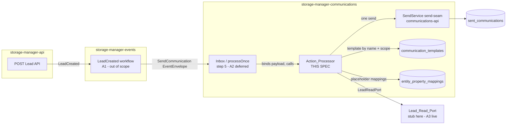

# Design Document

## Overview

This feature adds the **lead communication action** to the `storage-manager-communications` service: the behavior that interprets a `SendCommunication` action produced by `storage-manager-events` (in reaction to a `LeadCreated` event), resolves its single recipient and channel, personalizes a template, and performs exactly one audited send.

The deliverable is two tightly related things:

1. **A locked-down action contract** — the concrete JSON shape of the `Send_Communication_Action` carried inside the `payload` field of a canonical `EventEnvelope` whose `eventType` equals `SendCommunication`, and the Java record (`SendCommunicationAction`) it binds to in this Spring Boot service.
2. **An `Action_Processor` component** — the orchestration that binds the envelope, derives a correlation id, parses and validates the action, resolves the template within the lead's scope, resolves the single recipient and its channel, personalizes content via `entity-api` mappings, and invokes the existing `communications-api` send seam exactly once.

This spec **reuses, and does not redefine**, four existing capabilities already present in this codebase:

| Reused capability | Owner spec | What this spec uses | Key existing types |
|---|---|---|---|
| Canonical `EventEnvelope` + idempotent inbox / `processOnce` | `messaging` | Binds the action out of `payload`; derives correlation id; runs inside the inbox handler | `messaging.EventEnvelope`, `com.storagemanager.messaging.api.IdempotentInbox`, `InboundRecordingService` |
| `Communication_Template` store (org/facility scope, `emailContent`/`smsContent`, `{{placeholder}}`) | `communication-template-api` | Reads a template by name within the lead's scope | `model.CommunicationTemplate`, `repository.CommunicationTemplateRepository` |
| `Entity_Property_Mapping` (`(entityType, placeholder)` → `jsonProperty`) | `entity-api` | Resolves `{{placeholder}}` inner names to lead JSON property names for `LEAD` | `model.EntityPropertyMapping`, `model.EntityType`, `repository.EntityPropertyMappingRepository` |
| Send seam (stub `Delivery_Provider`, `Sent_Communication` audit, `EMAIL`/`SMS`, `Recipient_Type`) | `communications-api` | Invokes a single send per resolved recipient | `service.SendService`, `model.MessageType`, `model.RecipientType`, `model.SentCommunication` |

Actual third-party delivery stays **stubbed/no-op**, inherited from `communications-api`. Because this service does not own the Lead, Organization, Facility, or user-identity tables, lead data is read through a new `Lead_Read_Port` interface with a test stub; the live cross-repository wiring is External Assumption A3.

**Scope note.** Each action targets exactly one end user and produces exactly one send. Fan-out to many recipients (for example every owner of an organization) is modeled as several independent `SendCommunication` actions on the explicit email/phone path, each produced by `storage-manager-events` (External Assumption A1). Step 5 — the inbox path that admits a `SendCommunication` envelope and invokes the `Action_Processor` through `processOnce` — is deferred (A2); this spec defines the `Action_Processor` contract that step 5 will call.

### Resolving the open decisions

| Decision | Resolution in this design | Rationale |
|---|---|---|
| **D1 — Action `eventType` value** | `eventType == "SendCommunication"` (exact string match). | Matches the name reserved in the `messaging` spec's deferred-scope notes (A5) and the events-side producer (A1). A single constant `SendCommunicationAction.EVENT_TYPE` is the one source of truth. |
| **D2 — Recipient-type representation** | **Absent value** activates the explicit path. `recipientType` is an **optional** field that is either the string `"LEAD"` or omitted/null; there is no `EXPLICIT` enum member. | The reused `communications-api` `RecipientType` enum (`LEAD`, `OWNER`) is a stable, shared type this spec must not widen. Introducing `EXPLICIT` would force a change to a type owned by another spec and persisted on `Sent_Communication`. An absent `recipientType` is unambiguous: it is the **only** condition that activates the explicit path, and it pairs naturally with the optional `explicitRecipient`. See "Recipient-type representation (D2)" under Components. |
| **D3 — Null placeholder handling** | Substitute the **empty string** for a placeholder whose matching mapping resolves to an absent/null lead property. A placeholder with **no mapping at all** is still a hard rejection (Req 6.3). | Distinguishes "the template author referenced a defined field that happens to be empty for this lead" (benign, → empty string, Req 6.5) from "the template references a field with no mapping" (authoring/config error, → reject, Req 6.3). |
| **D4 — Tenant reference on the send** | Map `Lead_Id` onto the `Sent_Communication.tenantId` audit field via `SendService`. | `communications-api` `Sent_Communication` carries a nullable `tenantId` (Req 5.10) with no other natural owner on a lead send; the lead is the subject entity, so its id is the most useful trace value. |

## Architecture

### Position in the end-to-end lead flow



The thick box is this spec. `storage-manager-api`, the events workflow (A1), the inbox admission wiring (A2), the live `Lead_Read_Port` (A3), and the real delivery provider (A5) are all out of scope.

### Package layout

New and reused types under `com.storagemanager.communications`:

| Package | New types | Reused as-is |
|---|---|---|
| `action` (new) | `SendCommunicationAction` (record), `ActionProcessor`, `ActionProcessingException`, `ActionValidationException`, `ActionRetryableException`, `ResolvedRecipient`, `ActionResult` | — |
| `action.lead` (new) | `LeadReadPort` (interface), `LeadView` (record), `StubLeadReadPort` (test/profile stub), `LeadNotFoundException` | — |
| `service` | `TemplatePersonalizer` (new; placeholder substitution) | `SendService`, `DeliveryProviderRegistry`, stubs |
| `model` | — | `MessageType`, `RecipientType`, `EntityType`, `CommunicationTemplate`, `EntityPropertyMapping`, `SentCommunication`, `SendCommunicationRequest` |
| `repository` | — | `CommunicationTemplateRepository`, `EntityPropertyMappingRepository` |
| `messaging` | — | `EventEnvelope` |

> **Important reuse decision.** The `Action_Processor` dispatches by building a `SendCommunicationRequest` and calling the **existing** `SendService.send(...)`. That one method already performs the stub dispatch, `Sent_Communication` persistence, `status = DISPATCHED`, `dateSent`, `publicId`, and single-transaction rollback (communications-api Req 1, 5, 7). This spec adds no second send path and no new audit entity. The one wrinkle is caller identity: `SendService.send` resolves org/role from `authz.getCurrentUserIdentity()`. In the inbox path the "caller" is a system actor, not an interactive user. See "Dispatch via the reused send seam" for how the processor supplies organization/facility directly and avoids the interactive-user org-confinement branch.

### Processing sequence (happy path + rejection branches)

```mermaid
sequenceDiagram
    participant Inbox as Inbox (processOnce, step 5 / A2)
    participant AP as ActionProcessor
    participant LRP as LeadReadPort
    participant TR as CommunicationTemplateRepository
    participant TP as TemplatePersonalizer
    participant EPM as EntityPropertyMappingRepository
    participant SS as SendService (send seam)

    Inbox->>AP: process(envelope)
    AP->>AP: eventType == "SendCommunication"? (else not handled)
    AP->>AP: correlationId = envelope.correlationId ?? envelope.eventId
    AP->>AP: parse payload -> SendCommunicationAction (malformed -> reject 2.3)
    AP->>AP: validate action (entityKind=LEAD, leadId UUID, templateName, single-recipient) (Req 1)
    alt validation fails
        AP-->>Inbox: ActionValidationException (send seam invoked 0 times, Req 9.1)
    end
    AP->>LRP: findLead(leadId)
    alt lead missing
        AP-->>Inbox: ActionValidationException "lead not found" (Req 8.3)
    else read error
        AP-->>Inbox: ActionRetryableException (Req 8.4 -> redelivery)
    end
    LRP-->>AP: LeadView(orgId, facilityId, email, phone, preferredMethod, properties)
    AP->>TR: resolve template by name (facility-first then org) (Req 3)
    alt no template
        AP-->>Inbox: ActionValidationException "template not found" (Req 3.4)
    end
    AP->>AP: resolve recipient + channel (LEAD preferred-method OR explicit) (Req 4,5)
    AP->>AP: select channel content (emailContent/smsContent); missing -> reject (Req 4.5/4.6)
    AP->>EPM: placeholders for LEAD
    AP->>TP: personalize(content, mappings, leadProperties)
    alt unmapped placeholder
        AP-->>Inbox: ActionValidationException "unresolved placeholder" (Req 6.3)
    end
    TP-->>AP: personalized content
    AP->>SS: send(ONE SendCommunicationRequest) exactly once (Req 7.1)
    alt send raises
        AP-->>Inbox: ActionRetryableException (Req 7.5 -> redelivery)
    end
    SS-->>AP: SentCommunication
    AP-->>Inbox: ActionResult.processed (inbox stamps processed_at, Req 7.4)
```

Two outcome classes drive inbox behavior (Req 9):

- **Validation rejection** — a deterministic defect in the action, lead data, template, or placeholders. The send seam is invoked **zero** times (Req 9.1). Re-running the identical action would fail identically, so these are **not** retried; the processor signals a terminal rejection and the inbox marks the message processed (it will never succeed). See Error Handling for why rejections consume the message rather than loop forever.
- **Retryable error** — a transient failure: the send seam raised (Req 7.5) or the `Lead_Read_Port` raised while reading (Req 8.4). The processor surfaces a retryable error so the inbox leaves `processed_at` unstamped and the message is eligible for redelivery (messaging Req 5.5). Because one action = one send, a retry re-attempts exactly that single send.

## Components and Interfaces

### The `SendCommunicationAction` contract (the locked-down schema)

This is the concrete object the user asked to pin down. It is the JSON carried in `EventEnvelope.payload` when `eventType == "SendCommunication"`, and the Java record it binds to.

#### Wire JSON shape

```jsonc
// EventEnvelope.payload when eventType == "SendCommunication"
{
  "entityKind":       "LEAD",                                   // required; only LEAD supported (Req 1.1, 1.2)
  "leadId":           "7b9d6c1e-2f3a-4b5c-8d9e-0a1b2c3d4e5f",   // required; UUID string (Req 1.3, 1.8)
  "templateName":     "lead-welcome",                           // required; non-blank String (Req 1.4)
  "recipientType":    "LEAD",                                   // optional; "LEAD" or omitted/null (Req 1.5, D2)
  "explicitRecipient": null                                     // optional; one literal email OR phone (Req 1.6)
}
```

Explicit-recipient example (no `recipientType`):

```jsonc
{
  "entityKind":       "LEAD",
  "leadId":           "7b9d6c1e-2f3a-4b5c-8d9e-0a1b2c3d4e5f",
  "templateName":     "owner-notice",
  "explicitRecipient": "owner@example.com"                      // email -> EMAIL; a phone string -> SMS (Req 4.2, 5.2)
}
```

**Field semantics, locked:**

| Field | JSON type | Required | Semantics |
|---|---|---|---|
| `entityKind` | string (enum name) | yes | Subject-entity kind. Bound to `EntityType` (owned by `entity-api`). Only `LEAD` is supported; any other value → rejection "unsupported entity kind" (Req 1.2). Absent → rejection naming `entityKind` (Req 1.7). |
| `leadId` | string (UUID) | yes | The lead the action refers to. Absent → rejection naming `leadId` (Req 1.7); syntactically invalid UUID → rejection naming `leadId` (Req 1.8). |
| `templateName` | string | yes | Name of the `Communication_Template` to resolve within the lead's scope. Absent/blank → rejection naming `templateName` (Req 1.7). |
| `recipientType` | string (`"LEAD"`) | no | `"LEAD"` selects the lead-recipient path; **absent/null** activates the explicit path (D2). Any value other than `"LEAD"` or null is invalid (see binding note). |
| `explicitRecipient` | string | no | Exactly one literal email address or phone number. Used **only** when `recipientType` is absent (Req 1.6). Ignored-and-rejected if present alongside `recipientType == "LEAD"` (Req 1.9). |

#### Java record (DTO)

```java
package com.storagemanager.communications.action;

import com.fasterxml.jackson.annotation.JsonIgnoreProperties;
import com.storagemanager.communications.model.EntityType;
import com.storagemanager.communications.model.RecipientType;

/**
 * The SendCommunication action payload, carried inside EventEnvelope.payload when
 * eventType == SendCommunicationAction.EVENT_TYPE. Bound from the envelope payload map by the
 * ActionProcessor via Jackson. All cross-field validation lives in ActionProcessor so each
 * rejection can name the specific offending condition (Requirement 1).
 *
 * recipientType is deliberately the shared communications-api RecipientType restricted at
 * validation time to LEAD or null (D2): an absent value activates the explicit-recipient path.
 */
@JsonIgnoreProperties(ignoreUnknown = true)
public record SendCommunicationAction(
        EntityType entityKind,        // required; must be LEAD (Req 1.1, 1.2)
        String leadId,                // required; parsed to UUID by the processor (Req 1.3, 1.8)
        String templateName,          // required; non-blank (Req 1.4)
        RecipientType recipientType,  // optional; LEAD or null (Req 1.5, D2)
        String explicitRecipient      // optional; one email or phone literal (Req 1.6)
) {
    public static final String EVENT_TYPE = "SendCommunication";
}
```

**Serialization / binding decisions:**

- `leadId` is typed as **`String`**, not `UUID`, on purpose. Req 1.8 requires a *processing-error rejection naming the `leadId` field* for a syntactically invalid UUID. If the field were a `UUID`, Jackson would fail binding generically ("malformed payload", Req 2.3) and could not name `leadId`. Binding as a string lets `ActionProcessor` parse it with `UUID.fromString(...)` and raise a field-named validation error (Req 1.8).
- `entityKind` and `recipientType` bind to the existing enums (`EntityType`, `RecipientType`). An unknown enum string in the payload makes payload binding fail → treated as malformed payload (Req 2.3). A missing/null `entityKind` is caught by the processor's required-field check (Req 1.7). A `recipientType` other than `LEAD` (for example `OWNER`) is rejected by the processor as an unsupported single-recipient selection, keeping D2's "only `LEAD` or absent" rule explicit rather than leaning on enum membership.
- `@JsonIgnoreProperties(ignoreUnknown = true)` keeps the action forward-compatible: a future events-side additive field does not break binding here.
- The processor binds the payload via `objectMapper.convertValue(envelope.payload(), SendCommunicationAction.class)`, wrapping any `IllegalArgumentException`/`InvalidFormatException` as the malformed-payload rejection (Req 2.3).

### `ActionProcessor` (`action` package)

The orchestration component. In step 5 (A2) it will be invoked as the inbox `processOnce` handler for `eventType == SendCommunication`; this spec defines its contract so that wiring can call it.

```java
public interface ActionProcessor {
    /**
     * Interprets a SendCommunication action carried in the envelope and performs exactly one send.
     * @throws ActionValidationException  terminal rejection; send seam invoked zero times (Req 9.1)
     * @throws ActionRetryableException   transient failure; message eligible for redelivery (Req 9.2)
     */
    ActionResult process(EventEnvelope envelope);
}
```

Responsibilities, in order:

1. **Envelope binding + eventType guard (Req 2.1).** Only act when `envelope.eventType().equals(SendCommunicationAction.EVENT_TYPE)`. (In step 5 the inbox routes only matching envelopes; the guard keeps the contract explicit and testable.)
2. **Correlation id derivation (Req 2.2, 2.4).** `correlationId = envelope.correlationId() != null ? envelope.correlationId() : envelope.eventId()`. Carried through to the send.
3. **Payload parse (Req 2.3).** `convertValue` to `SendCommunicationAction`; failure → malformed-payload rejection.
4. **Action validation (Req 1).** Required fields present (`entityKind`, `leadId`, `templateName`); `entityKind == LEAD`; `leadId` a valid UUID; **single-recipient selection** — exactly one of (`recipientType == LEAD`) xor (`explicitRecipient` present). Both present → reject (Req 1.9); neither present → reject "explicit recipient required" (Req 5.3).
5. **Lead read (Req 3.1, 8).** `leadReadPort.findLead(leadId)` → `LeadView`. Empty → "lead not found" rejection (Req 8.3). Thrown error → retryable (Req 8.4).
6. **Template resolution (Req 3).** Facility-first then org (see `TemplateResolver` logic below). No match → "template not found" rejection (Req 3.4).
7. **Recipient + channel resolution (Req 4, 5).** `LEAD` path uses `LeadView.preferredMethod` + contact; explicit path infers channel from the literal's shape. Produces a `ResolvedRecipient`.
8. **Channel content selection (Req 4.3–4.6).** `EMAIL` → `emailContent`; `SMS` → `smsContent`; missing content for the channel → rejection (Req 4.5/4.6).
9. **Personalization (Req 6).** `TemplatePersonalizer.personalize(content, leadMappings, leadProperties)`.
10. **Dispatch (Req 7).** Build one `SendCommunicationRequest`; call `SendService.send(...)` exactly once. Send raised → retryable (Req 7.5). Success → `ActionResult.processed` (Req 7.4).

#### Recipient-type representation (D2) in code

The single-recipient decision is a two-value selection expressed with the optional fields:

```text
selection = (recipientType == LEAD, explicitRecipient present)
  (true,  false) -> LEAD path          (Req 5.1)
  (false, true)  -> explicit path      (Req 5.2)
  (true,  true)  -> reject  (Req 1.9: "single recipient selection required")
  (false, false) -> reject  (Req 5.3: "explicit recipient required")
```

No `EXPLICIT` enum value is introduced (D2). The only signal for the explicit path is an absent `recipientType`.

### Recipient + channel resolution (`ResolvedRecipient`)

```java
/** The single concrete send target: exactly one channel and one matching contact value. */
public record ResolvedRecipient(MessageType channel, String contactValue, RecipientType auditRecipientType) {}
```

- **LEAD path (Req 4.1, 5.1, 5.4).** `channel = leadView.preferredMethod()` (an `EMAIL`/`SMS`). `contactValue` = `leadView.email()` for `EMAIL`, `leadView.phone()` for `SMS`. If that contact is absent/blank → reject "lead lacks a contact for the preferred channel" (Req 4.7). `auditRecipientType = LEAD`, passed to the send so `Sent_Communication.recipientType == LEAD` (Req 5.4).
- **Explicit path (Req 4.2, 5.2, 5.5).** Infer channel from the literal using the same pragmatic email/phone checks already used by `SendService` (reused notion): an email-shaped literal → `EMAIL` + that email; a phone-shaped literal → `SMS` + that phone; neither → reject naming `explicitRecipient` (Req 5.5). `auditRecipientType = null` (no lead recipient role; the send records the explicit address only).

> **Channel-check consistency.** The explicit-path email/phone classification must agree with `SendService`'s own format validation (which runs again inside `send`). To avoid drift, the email/phone predicates are extracted into a small shared helper (`ContactFormat`) used by both the processor's classification and — where practical — mirrored by `SendService`'s existing patterns. At minimum the processor uses the same regexes documented in `SendService` so a value the processor classifies as `EMAIL` is never rejected as a malformed email by `send`.

### `TemplateResolver` logic (facility-first then org)

Template resolution reuses `CommunicationTemplateRepository`. The existing repository exposes org-scoped listing and name existence checks but not a direct "by name within (org, facility)" finder, so this spec adds two derived finders to that repository (a read-only extension, consistent with how `CommunicationService` already queries it):

```java
// added to CommunicationTemplateRepository (read-only finders for scope resolution, Req 3)
Optional<CommunicationTemplate> findByOrganizationIdAndFacilityIdAndTemplateName(
        UUID organizationId, UUID facilityId, String templateName);              // facility-level (Req 3.2)
Optional<CommunicationTemplate> findByOrganizationIdAndFacilityIdIsNullAndTemplateName(
        UUID organizationId, String templateName);                               // org-level (Req 3.3)
```

Resolution order (Req 3.2, 3.3, 3.5):

```text
1. if lead.facilityId != null:
     facilityMatch = findByOrganizationIdAndFacilityIdAndTemplateName(orgId, facilityId, name)
     if present -> use it (facility-level preferred, Req 3.5)
2. orgMatch = findByOrganizationIdAndFacilityIdIsNullAndTemplateName(orgId, name)
     if present -> use it (Req 3.3)
3. else -> reject "template not found" (Req 3.4)
```

### `TemplatePersonalizer` (`service` package)

A pure function over `(content, mappings, leadProperties)`; no I/O, which makes it the strongest property-testing target.

```java
public final class TemplatePersonalizer {
    /**
     * Replaces every {{inner-name}} occurrence with the lead property value selected by the
     * matching Entity_Property_Mapping. Totality: every placeholder is either substituted or the
     * whole call fails with UnresolvedPlaceholderException naming the first unmapped inner name.
     *
     * @param content        template content (emailContent or smsContent)
     * @param placeholderToJsonProperty  (entityType=LEAD) placeholder inner-name -> jsonProperty
     * @param leadProperties jsonProperty -> value from the LeadView (may hold null/absent)
     */
    public String personalize(String content,
                              Map<String,String> placeholderToJsonProperty,
                              Map<String,Object> leadProperties);
}
```

Rules (Req 6):

- Placeholder grammar matches the `communication-template-api` convention: `{{` + inner-name + `}}`, where inner-name is the kebab-case `Entity_Property_Mapping.placeholder` (`^[a-z0-9]+(-[a-z0-9]+)*$`). A single regex (`\{\{\s*([a-z0-9-]+)\s*\}\}`) locates occurrences.
- For each occurrence, look up the inner name in `placeholderToJsonProperty` (built from `EntityPropertyMappingRepository` rows where `entityType == LEAD`). **No mapping → `UnresolvedPlaceholderException`** → validation rejection naming the placeholder (Req 6.3).
- Mapping present → read `leadProperties.get(jsonProperty)`. **Absent/null → empty string** (Req 6.5, D3). Present → its string form.
- No placeholders → content returned unchanged (Req 6.4).
- Same inner name repeated → every occurrence gets the **same** resolved value (Req 6.6) — guaranteed because resolution is a pure function of the inner name.

### `LeadReadPort` and its stub (`action.lead` package)

The read seam that insulates this service from the Lead/Org/Facility tables (Req 8; A3 for the live impl).

```java
public interface LeadReadPort {
    /** @return the lead view, or Optional.empty() if no lead exists for the id (Req 8.3).
     *  @throws LeadReadException on a transient read failure (Req 8.4 -> retryable). */
    Optional<LeadView> findLead(UUID leadId);
}

/** Everything the Action_Processor needs about a lead (Req 8.1). */
public record LeadView(
        UUID organizationId,              // lead's org (Req 3.1)
        UUID facilityId,                  // lead's facility, nullable (Req 3.1)
        String email,                     // Lead_Contact email, nullable
        String phone,                     // Lead_Contact phone, nullable
        MessageType preferredMethod,      // Preferred_Contact_Method (Req 4.1)
        Map<String,Object> properties     // jsonProperty -> value, for personalization (Req 6.2)
) {}
```

- `StubLeadReadPort` (Req 8.2) returns configured `LeadView`s from an in-memory map without calling `storage-manager-api`. It is the only implementation in this spec (active under test and the local profile); the live HTTP implementation is A3.
- The `properties` map is keyed by `jsonProperty` (the `Entity_Property_Mapping.jsonProperty` value), matching how personalization looks values up (Req 6.2). The stub supplies these values directly.

### Dispatch via the reused send seam

The processor builds exactly one `SendCommunicationRequest` and calls the existing `SendService.send(...)` (communications-api). Mapping (Req 7.2):

| `SendCommunicationRequest` field | Value from the action/resolution |
|---|---|
| `facilityId` | `leadView.facilityId()` |
| `messageType` | `resolvedRecipient.channel()` |
| `messageContent` | personalized content |
| `phoneNumber` / `emailAddress` | the single matching contact (other left null) |
| `emailSubject` | null (no subject in this spec's action; left for a future field) |
| `recipientType` | `resolvedRecipient.auditRecipientType()` (`LEAD` or null) |
| `tenantId` | `leadId` (D4) |
| `userId` | null |
| `correlationId` | derived correlation id (Req 2.4) |
| `organizationId` | `leadView.organizationId()` |

**Caller-identity caveat (design decision).** `SendService.send` today resolves org/role from `authz.getCurrentUserIdentity()` and, for a non-ADMIN caller, confines `organizationId` to the token org. In the inbox path there is no interactive user — the authoritative org comes from the lead's `organizationId` (itself carried on the admitted envelope's `scope_0`). To invoke the seam without the interactive-user confinement branch, the design takes the narrowest viable option and records it explicitly:

- **Chosen:** add a thin package-visible internal entry on `SendService` — `sendInternal(SendCommunicationRequest request)` — that performs the identical dispatch/persist logic but treats the supplied `organizationId` as authoritative (system actor), skipping the `authz` org-confinement branch. The public HTTP `send(...)` keeps its current behavior unchanged. This is a small, additive change to a collaborator and keeps a single real send/persist implementation (the two methods share a private core). The alternative — synthesizing a system `UserIdentity` into the security context around the call — is rejected as more fragile and surprising.

This caveat is the one place this spec touches a `communications-api`-owned type; it is additive and preserves the existing public contract. It is also surfaced to the reviewer as an explicit decision rather than buried.

## Data Models

This spec introduces **no new persistent entity and no new migration**. It reads existing tables (`communication_templates`, `entity_property_mappings`) and writes through the existing send seam (`sent_communications`). The data models below are the in-memory action/port types.

### `SendCommunicationAction` (payload DTO) — field reference

| Field | Java type | JSON | Required | Validation owner |
|---|---|---|---|---|
| `entityKind` | `EntityType` | `"LEAD"` | yes | processor: present (1.7) + `== LEAD` (1.2) |
| `leadId` | `String` | UUID string | yes | processor: present (1.7) + `UUID.fromString` (1.8) |
| `templateName` | `String` | string | yes | processor: non-blank (1.7) |
| `recipientType` | `RecipientType` | `"LEAD"`/absent | no | processor: `LEAD` or null (D2) |
| `explicitRecipient` | `String` | email/phone literal | no | processor: single-recipient xor (1.9/5.3), format (5.5) |

### `LeadView` (read-seam projection)

| Field | Type | Null | Used by |
|---|---|---|---|
| `organizationId` | `UUID` | no | template resolution (3), send org (7.2) |
| `facilityId` | `UUID` | yes | template facility-scope (3.2), send facility (7.2) |
| `email` | `String` | yes | LEAD/EMAIL contact (4.3, 5.1) |
| `phone` | `String` | yes | LEAD/SMS contact (4.4, 5.1) |
| `preferredMethod` | `MessageType` | no | LEAD channel (4.1) |
| `properties` | `Map<String,Object>` | no (may be empty) | personalization (6.2, 6.5) |

### `ResolvedRecipient`

| Field | Type | Meaning |
|---|---|---|
| `channel` | `MessageType` | `EMAIL` or `SMS` (Req 4) |
| `contactValue` | `String` | the single matching contact (Req 4.3/4.4, 5) |
| `auditRecipientType` | `RecipientType` (nullable) | `LEAD` for the lead path, null for explicit (Req 5.4) |

### Mapping-set projection for personalization

The processor builds `placeholderToJsonProperty: Map<String,String>` for `entityType == LEAD` by reading `EntityPropertyMapping` rows (via the existing repository — the rows carry both `placeholder` and `jsonProperty`). This is the authority for "which placeholders are defined" (Req 6.1, 6.3) and "what lead property each resolves to" (Req 6.2). Entity-api remains the sole writer of these rows; this spec only reads them.

## Correctness Properties

*A property is a characteristic or behavior that should hold true across all valid executions of a system — essentially, a formal statement about what the system should do. Properties serve as the bridge between human-readable specifications and machine-verifiable correctness guarantees.*

These properties were derived from the acceptance-criteria prework and consolidated to remove redundancy. The pervasive "SHALL NOT invoke the Send_Seam" clause attached to every rejection criterion is factored out into a single cross-cutting invariant (Property 10). The many "what a successful send produces" clauses collapse into Property 1; recipient/channel resolution into Property 3; the rejection-by-cause families into Properties 4–8. Structural/routing facts (1.1, 1.3–1.6, 2.1, 3.1, 8.1), the reused stub's behavior (7.3), and the test-infra stub (8.2) are covered by example/integration/smoke tests in the Testing Strategy, not by properties.

The `Action_Processor` is tested against the existing in-memory fake-repository + counting-stub pattern (see Testing Strategy), so every property below runs at 100+ iterations without a database.

### Property 1: A successful action produces exactly one correctly-mapped send

*For any* action that passes all validation (LEAD or explicit path), with a resolvable template carrying content for the resolved channel and placeholders that all resolve, processing the action SHALL invoke the send seam **exactly once** with a request whose `messageType` equals the resolved channel, whose single channel-matching contact equals the resolved contact value (the other contact null), whose `messageContent` equals the personalized content, whose `facilityId` and `organizationId` equal the lead's, whose `tenantId` equals the `Lead_Id`, whose `recipientType` equals `LEAD` on the lead path and null on the explicit path, and whose `correlationId` equals the derived correlation id; and processing SHALL report the action as successfully processed.

**Validates: Requirements 2.4, 4.3, 4.4, 5.1, 5.2, 5.4, 7.1, 7.2, 7.4**

### Property 2: Personalization substitutes mapped placeholders totally and consistently

*For any* template content, any set of `LEAD` `Entity_Property_Mapping` rows, and any lead property map, personalization SHALL either (a) produce output in which every `{{inner-name}}` occurrence whose inner name has a mapping is replaced — by the lead property named by that mapping's `jsonProperty`, or by the empty string when that property is absent or null, with every occurrence of the same inner name replaced by the identical value and content containing no placeholders returned unchanged — or (b) reject the action naming the first `{{inner-name}}` whose inner name has no `LEAD` mapping.

**Validates: Requirements 6.1, 6.2, 6.3, 6.4, 6.5, 6.6**

### Property 3: Recipient and channel resolution yields exactly one target

*For any* validated action, recipient resolution SHALL yield exactly one `Resolved_Recipient`: on the LEAD path the channel equals the lead's `Preferred_Contact_Method` and the contact is the lead's email for `EMAIL` or phone for `SMS`; on the explicit path the channel is `EMAIL` when the explicit literal is a syntactically valid email and `SMS` when it is a syntactically valid phone number, with the contact equal to that literal.

**Validates: Requirements 4.1, 4.2, 5.1, 5.2**

### Property 4: Template resolution prefers facility scope and rejects when neither scope matches

*For any* lead (with or without a facility) and any template name, template resolution SHALL select the facility-level template whose `(organizationId, facilityId)` and `templateName` match when one exists; otherwise the org-level template whose `(organizationId, null)` and `templateName` match when one exists; and when both a facility-level and an org-level template match it SHALL select the facility-level one; and when neither matches it SHALL reject the action indicating the template was not found.

**Validates: Requirements 3.2, 3.3, 3.4, 3.5**

### Property 5: An action selects exactly one recipient

*For any* action, processing SHALL succeed in selecting a recipient only when exactly one of (a `recipientType` of `LEAD`) or (a supplied `explicitRecipient`) is present: an action supplying both SHALL be rejected as requiring a single recipient selection; an action supplying neither SHALL be rejected as requiring an explicit recipient; and an action whose supplied `explicitRecipient` is neither a syntactically valid email nor a syntactically valid phone number SHALL be rejected naming the explicit-recipient value.

**Validates: Requirements 1.9, 5.3, 5.5, 9.3**

### Property 6: Structurally invalid actions are rejected

*For any* action payload that omits a required field (`entityKind`, `leadId`, or `templateName`), carries an `entityKind` other than `LEAD`, carries a `leadId` that is not a syntactically valid UUID, or cannot be parsed into a `Send_Communication_Action`, processing SHALL reject the action with a processing error identifying the offending condition.

**Validates: Requirements 1.2, 1.7, 1.8, 2.3**

### Property 7: Missing channel content or preferred-channel contact is rejected

*For any* validated action, when the selected template has no content for the resolved channel (`EMAIL` with no `emailContent`, or `SMS` with no `smsContent`), or the action is on the LEAD path and the lead has no contact value for its preferred channel, processing SHALL reject the action indicating, respectively, that the template lacks content for the channel or that the lead lacks a contact for the preferred channel.

**Validates: Requirements 4.5, 4.6, 4.7**

### Property 8: A missing lead is rejected

*For any* action whose `Lead_Read_Port` lookup reports that no lead exists for the `Lead_Id`, processing SHALL reject the action indicating the lead was not found.

**Validates: Requirements 8.3**

### Property 9: Transient failures are surfaced as retryable

*For any* validated action whose single send seam invocation raises an error, or whose `Lead_Read_Port` raises an error while reading lead data, processing SHALL surface a retryable processing error so the originating message remains eligible for redelivery.

**Validates: Requirements 7.5, 8.4, 9.2**

### Property 10: Any validation rejection invokes the send seam zero times

*For any* action that processing rejects for a validation error (any rejection defined by Requirements 1, 2, 3, 4, 5, 6, or 8), the send seam SHALL be invoked exactly zero times for that action.

**Validates: Requirements 9.1**

### Property 11: Correlation id derivation

*For any* `EventEnvelope`, the correlation id the processor derives and carries to the send SHALL equal the envelope's `correlationId` when it is non-null and the envelope's `eventId` when the `correlationId` is null.

**Validates: Requirements 2.2**

## Error Handling

The processor raises one of two exception families; nothing in this spec returns an HTTP status directly (the inbox/`processOnce` path, step 5 / A2, decides how a raised error maps onto message acknowledgement).

| Condition | Exception | Outcome | Requirement |
|---|---|---|---|
| Missing required field / non-LEAD entityKind / invalid-UUID leadId / malformed payload | `ActionValidationException` | terminal reject; 0 sends | 1.2, 1.7, 1.8, 2.3, 9.1 |
| Both LEAD + explicit / neither / bad explicit literal | `ActionValidationException` | terminal reject; 0 sends | 1.9, 5.3, 5.5, 9.3 |
| No template in facility or org scope | `ActionValidationException` | terminal reject; 0 sends | 3.4 |
| Template lacks content for channel / lead lacks preferred-channel contact | `ActionValidationException` | terminal reject; 0 sends | 4.5, 4.6, 4.7 |
| Unmapped `{{placeholder}}` | `ActionValidationException` (`UnresolvedPlaceholderException` cause) | terminal reject; 0 sends | 6.3 |
| Lead not found | `ActionValidationException` | terminal reject; 0 sends | 8.3 |
| Send seam raised | `ActionRetryableException` | redeliver | 7.5, 9.2 |
| Lead_Read_Port raised | `ActionRetryableException` | redeliver | 8.4, 9.2 |

Key behaviors:

- **Validation vs retryable is the central split (Req 9).** A validation rejection is a deterministic defect in the message or referenced data: replaying the identical action yields the identical rejection. Surfacing it as retryable would loop the inbox forever on a poison message. So `ActionValidationException` is **terminal** — the processor signals the message was handled (and consumed) even though no send occurred; the send seam ran **zero** times (Property 10, Req 9.1). A retryable error is transient (dispatch failure, read failure): the processor surfaces `ActionRetryableException` so the inbox leaves `processed_at` unstamped and the message is redelivered (messaging Req 5.5). Because one action yields exactly one send, a retry re-attempts only that single send (Req 9.2).
- **Zero-send invariant.** Every validation branch returns/throws **before** the single `SendService.send(...)` call site, which is the last statement of the happy path. A counting stub provider asserts zero invocations on every rejection (Property 10).
- **Rejections name the offending condition.** Each `ActionValidationException` message names the specific cause (the field, the placeholder, the explicit value, the template, or the lead) per the EARS clauses, so step 5 can log a precise poison-message reason.
- **Reused stub never fails in-spec.** The `communications-api` stub `Delivery_Provider` reports success and transmits nothing (A5, Req 7.3); the retryable "send raised" branch is exercised in tests by substituting a throwing `SendService`/provider, not by the real stub.

## Testing Strategy

The service already uses **jqwik** (`net.jqwik:jqwik` + `jqwik-spring`, test scope; a `.jqwik-database` is present) with existing property tests under `src/test/java/.../property` (for example `EntityMappingRoundTripPropertyTest`), and an in-memory **Mockito-backed fake repository** pattern that mimics `@PrePersist` by assigning id/timestamps on `save`. This feature follows that exact approach. Property-based testing **is appropriate** here: the `Action_Processor`, `TemplatePersonalizer`, recipient/channel resolution, and template resolution are pure-logic components with universal properties (single-recipient invariant, exactly-one-send, placeholder substitution totality) over large input spaces.

### Dual approach

- **Property-based tests (jqwik):** one `@Property(tries = 100)` test per correctness property (Properties 1–11). The processor is driven against:
  - a **fake `CommunicationTemplateRepository`** seeded with random org/facility/name templates (to exercise facility-first-then-org resolution),
  - a **fake `EntityPropertyMappingRepository`** returning random `LEAD` placeholder→jsonProperty sets,
  - a **`StubLeadReadPort`** returning generated `LeadView`s (random org/facility/contacts/preferred-method/properties, including absent contacts and null property values), and
  - a **counting stub over the send seam** (`SendService` replaced by a spy/fake that records invocation count and the captured `SendCommunicationRequest`).
  Generators cover: LEAD vs explicit paths; email-shaped and phone-shaped explicit literals plus junk literals; both/neither recipient selections; present/absent `recipientType`; missing required fields; non-UUID `leadId`; malformed payload maps; templates with/without `emailContent`/`smsContent`; placeholder-free, mapped, unmapped, repeated, and null-valued placeholder content; present vs null envelope `correlationId`; and absent leads / throwing port / throwing send.
- **Example / edge-case unit tests:** the structural and single-scenario facts — `entityKind`/`leadId`/`templateName` field binding (1.1, 1.3, 1.4), `recipientType` LEAD-or-absent binding (1.5, 1.6), the `eventType == SendCommunication` guard (2.1), lead org/facility obtained via the port (3.1), and the `LeadReadPort` interface shape (8.1).
- **Integration / smoke tests:**
  - A Spring context test confirming `StubLeadReadPort` is wired and returns configured data under the test/local profile (8.2, SMOKE).
  - One example confirming the reused `communications-api` stub provider reports success and transmits nothing when driven through the processor (7.3, INTEGRATION) — the reused behavior is owned by `communications-api`; this is a thin wiring check, not a re-test.
  - An end-to-end example feeding a well-formed `SendCommunication` `EventEnvelope` through `ActionProcessor.process(...)` against the real `SendService` + fake repositories, asserting exactly one `SentCommunication` is persisted with the expected fields (ties Properties 1 and the send seam together at the integration seam).

### Property-based test configuration

- Minimum **100 iterations** per property test (`@Property(tries = 100)`), consistent with existing tests.
- A property-based testing library is **not** reimplemented; jqwik (already a dependency) is used.
- Each correctness property is implemented by a **single** property-based test.
- Each property test carries a comment referencing the design property and validated requirements, in the format **`Feature: lead-communication-action, Property {n}: {property text}`**, for example:

```java
/**
 * Feature: lead-communication-action, Property 10: Any validation rejection invokes the send seam zero times.
 * For any action that is rejected for a validation error (Req 1,2,3,4,5,6,8), SendService is
 * invoked exactly zero times.
 * Validates: Requirements 9.1
 */
@Property(tries = 100)
void anyValidationRejection_invokesSendZeroTimes(@ForAll("rejectableActions") RejectableCase c) { ... }
```

### Coverage mapping (summary)

| Property | Focus | Requirements |
|---|---|---|
| P1 | successful send: exactly-once + field mapping + audit type + correlation | 2.4, 4.3, 4.4, 5.1, 5.2, 5.4, 7.1, 7.2, 7.4 |
| P2 | personalization totality/consistency | 6.1, 6.2, 6.3, 6.4, 6.5, 6.6 |
| P3 | recipient + channel resolution | 4.1, 4.2, 5.1, 5.2 |
| P4 | template resolution (facility-first, reject none) | 3.2, 3.3, 3.4, 3.5 |
| P5 | single-recipient selection | 1.9, 5.3, 5.5, 9.3 |
| P6 | malformed / invalid action rejection | 1.2, 1.7, 1.8, 2.3 |
| P7 | missing channel content / preferred-channel contact | 4.5, 4.6, 4.7 |
| P8 | lead not found | 8.3 |
| P9 | retryable errors surfaced | 7.5, 8.4, 9.2 |
| P10 | zero-send-on-rejection (cross-cutting) | 9.1 |
| P11 | correlation id derivation | 2.2 |
| Example/edge | field binding, eventType guard, port usage, interface shape | 1.1, 1.3, 1.4, 1.5, 1.6, 2.1, 3.1, 8.1 |
| Integration/smoke | stub wiring, reused provider success, e2e envelope→send | 7.3, 8.2 |
